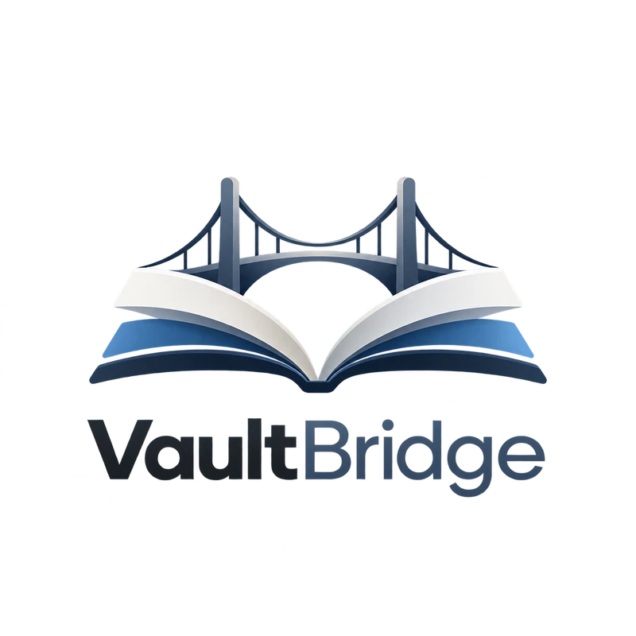
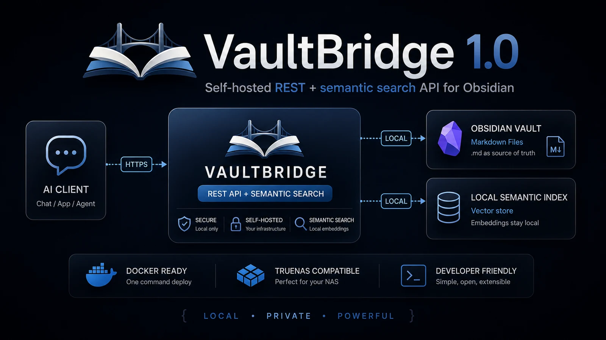

<p align="center">
  
</p>

# VaultBridge

**A self-hosted REST, MCP and semantic-search bridge for Markdown vaults.**
Use it to connect Obsidian notes to AI clients, scripts and automations while keeping your files
portable. Markdown remains the source of truth; local CPU embeddings and a rebuildable SQLite
index provide semantic retrieval. Your vault stays usable without VaultBridge.

[Stable v1.5.0](https://github.com/mrtrollex/VaultBridge/releases/tag/v1.5.0) ·
[MIT](LICENSE) · Python 3.12 · Linux/amd64 container

- Read, list, search, create and append notes through a small authenticated API.
- Find related notes and verified relationships; use bounded Knowledge Query and read-only Hygiene.
- Capture Markdown and explicitly review/promote it through the CLI.
- Start with one vault and the bundled Web Dashboard; opt into isolated Knowledge Spaces when needed.
- Keep embeddings local, note paths vault-relative and indexes disposable.

**Install:** follow the [Docker quick start](#quick-start), or use the
[TrueNAS Community App](README_TRUENAS.md#preferred-installation-truenas-community-app).
[Detailed setup and operations](docs/DOCKER.md) cover configuration, permissions and recovery.

## Quick start

This Linux/macOS shell example runs the published stable image in legacy single-vault mode.
Use Docker Engine/Desktop with Compose and an existing vault directory accessible to Docker.
The first start downloads the local embedding model; allow disk space and initial network access.

```bash
git clone https://github.com/mrtrollex/VaultBridge.git
cd VaultBridge
git checkout v1.5.0
cp .env.example .env
docker run --rm python:3.12-slim python -c 'import secrets; print(secrets.token_urlsafe(48))'
```

Using a local editor, put the generated key in `.env` and set the absolute host vault path:

```env
API_KEY=YOUR_GENERATED_API_KEY
OBSIDIAN_VAULT_PATH=/path/to/your/Obsidian/Vault
API_PORT=8765
PUID=1000
PGID=1000
```

On Linux, use the vault owner's `id -u` / `id -g` for `PUID` / `PGID`; grant deliberate read/write
access to the vault and derived-data directory. Docker Desktop mediates host permissions differently.
See [permissions and source-build setup](docs/DOCKER.md#quick-start) for Windows/Compose details.
Keep `.env` private and untracked. Do not paste resolved Compose configuration or container environments.

Create `compose.release.yml` beside `docker-compose.yml`:

```yaml
services:
  obsidian-api:
    image: ghcr.io/mrtrollex/vaultbridge:1.5.0
```

```bash
docker compose -f docker-compose.yml -f compose.release.yml pull
docker compose -f docker-compose.yml -f compose.release.yml up -d --no-build
curl -fsS http://127.0.0.1:8765/health/live
curl -i http://127.0.0.1:8765/health/ready
```

The service binds to host loopback port `8765`. Open `http://127.0.0.1:8765/ui/` for the legacy
Dashboard and unlock it with your key. Readiness may return `503` during initial indexing/model download;
inspect `/health` and Compose logs. A compatible existing index can remain searchable during refresh.

To test a read without changing notes, replace the placeholder with the key from `.env`:

```bash
curl -fsS 'http://127.0.0.1:8765/api/v1/notes/list?limit=5' \
  -H 'Authorization: Bearer YOUR_API_KEY'
```

Use the same two `-f` arguments for subsequent release-image Compose operations. To build from source
instead, follow [the generic Docker guide](docs/DOCKER.md). For immutable deployment, replace the image
tag with the verified digest from the [release ledger](docs/RELEASE_CHECKLIST.md#v150-release-evidence).
Back up Markdown, configuration and artifacts with writers stopped before upgrading an existing setup.

## Choose a mode

| | Legacy single vault (default) | Named Knowledge Spaces (advanced opt-in) |
| --- | --- | --- |
| Configuration | Omit `KNOWLEDGE_SPACES_JSON` | Explicit validated JSON and independent root/data mounts |
| Selection | Existing path-only/omitted-scope behavior | Explicit scopes; omission still selects default only |
| REST / MCP / CLI | Supported | Supported within configured policies and capabilities |
| Web Dashboard | Bundled `/ui/` | Deliberately unavailable, including assets/session routes |
| Index maintenance | Stopped-service CLI | Named status/index maintenance unsupported |

Named mode supports one to eight spaces, including exactly one `default`. A Bearer key authenticates
the deployment; configured server policy governs spaces. It does not create per-user permissions.
Generic Compose does not forward named JSON automatically.
See [Knowledge Spaces setup and limits](docs/KNOWLEDGE_SPACES.md) before opting in.

## Setup and integration guides

| I want to… | Start here |
| --- | --- |
| Install with Docker / use legacy mode | [Docker setup and operations](docs/DOCKER.md) |
| Install the TrueNAS Community App | [TrueNAS runbook](README_TRUENAS.md) |
| Configure named roots, policies and scopes | [Knowledge Spaces](docs/KNOWLEDGE_SPACES.md) |
| Use REST, health or semantic retrieval | [REST API guide](docs/API.md) |
| Connect an MCP client (stdio or HTTP) | [MCP integration](docs/MCP.md) |
| Use Query, Capture, Promotion or index maintenance | [CLI guide](docs/CLI.md) |
| Understand Dashboard sessions and privacy | [Legacy Dashboard](docs/DASHBOARD.md) |
| Develop or contribute | [Contributing](CONTRIBUTING.md), [development setup](DEVELOPMENT.md) |

## Security and operational limits

Use HTTPS through a trusted reverse proxy or a private VPN for remote access. Do not expose plain
HTTP publicly. VaultBridge provides note operations, not arbitrary filesystem access or a delete API.
MCP HTTP and MCP writes are separate opt-ins; stdio trusts the local launching process and OS permissions.
The default note-size limit is 1,000,000 bytes; oversized files can cause partial retrieval coverage.

Keep a single semantic writer per data layout. Stop serving/stdio before CLI writes or index maintenance
on the same writable state. Preserve uncertain-write requests/artifacts and reconcile before retry.
Named/v2 artifacts cannot be handed directly to v1.4.0 for an in-place downgrade.
See [security reporting](SECURITY.md), [architecture contracts](ARCHITECTURE.md) and
[release notes and recovery limits](docs/V150_RELEASE_NOTES.md).

## Project navigation

- [Product roadmap](ROADMAP.md) — candidate priorities, themes and non-goals
- [Backlog](BACKLOG.md#current-work-entry-point) — task contracts and current-work navigation
- [Current state](PROJECT_STATE.md) — compact factual snapshot and open operational gates
- [Changelog](CHANGELOG.md) and [release ledger](docs/RELEASE_CHECKLIST.md) — changes and evidence
- [Architecture](ARCHITECTURE.md) and [ADRs](docs/adr/) — current ownership and decisions
- [Codex Playbook](docs/CODEX_PLAYBOOK.md) — task, checks and fresh-review workflow
- [Documentation index](docs/README.md) and [history](docs/history/README.md)

<p align="center">
  
</p>

Read the [story behind v1.0](https://richardsenko.com/vaultbridge-1-0/).
VaultBridge is licensed under the [MIT License](LICENSE).
