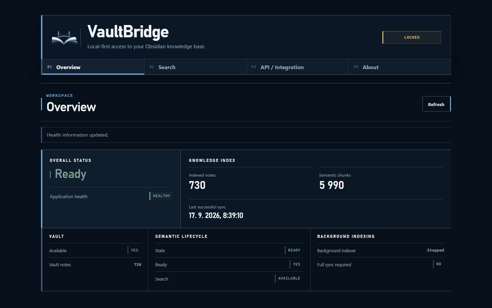
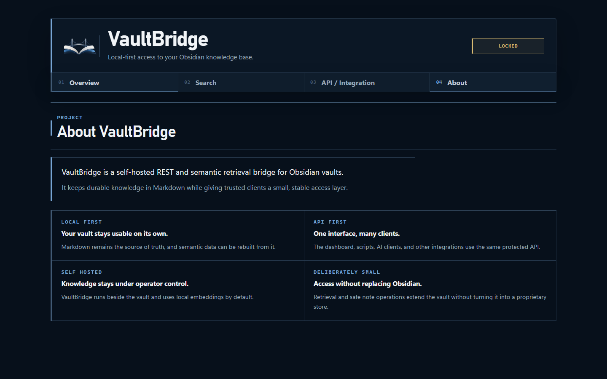

# Web Dashboard

The bundled `/ui/` Dashboard has separate legacy and named compositions. Published v1.5.0 retains
the legacy-only Dashboard. The accepted VB-156B named Access / Spaces / Status foundation merged
in PR #158. This working source adds VB-156C Browse, raw Markdown reading and federated Search
under [ADR 0011](adr/0011-named-knowledge-spaces-dashboard.md).
See [VB-156B acceptance and browser qualification](VB156B_QUALIFICATION.md) for the session
foundation and the build-specific limitations under ADR 0012.

## Named Access / Spaces / Status

With `KNOWLEDGE_SPACES_JSON`, `/ui/` serves a separate local document and exact bundled assets.
The named entry loads its own controllers and shares the bundled stylesheet and logo with the
legacy Dashboard. Knowledge Query, Relationships and named Hygiene presentation remain deferred.

Unlock with the existing current or previous API key. POST `/ui/session` issues the existing
current-key-signed HttpOnly cookie, host-only, Path=/, SameSite=Strict, Secure when ASGI sees HTTPS.
Named GET `/ui/session` validates only: it never renews, sets or deletes cookies, including failures.
The fixed expiry is seven days from explicit successful unlock; extending it requires key re-entry.
POST/GET return `{"authenticated":true}`; DELETE returns `{"authenticated":false}`. All methods
share the direct-peer limiter once. Named requests require `X-VaultBridge-UI-Request: 1`, reject
duplicate marker/Origin/Fetch Metadata headers, verify supplied Origin against effective scheme,
host and port, and accept only same-origin Fetch Metadata. Unlock requires JSON. No CORS is added.

Named protected UI requires a top-level secure context, native Web Locks and working shared
localStorage. Missing or rejected features leave the public shell with “Named browser sessions
unavailable”; there is no per-tab/Bearer fallback. BroadcastChannel is not required. Browser profiles
and storage partitions are separate sessions; private/embedded contexts are not universally qualified.
The five eligible build-specific profiles and reopening conditions are defined in accepted
[ADR 0012](adr/0012-vb-156b-qualification-amendment.md), with current outcomes in the
[qualification record](VB156B_QUALIFICATION.md). Windows Playwright WebKit 26.6 fails native
Strict-cookie delivery with both the production
application and an independent minimal issuer; it is **not qualified**. Linux WebKit 27.2 now runs
the native qualification after system dependencies were installed. Chromium/Firefox results do not
substitute for WebKit, and Linux results do not certify the deficient Windows port. See the
[qualification matrix and remaining gates](VB156B_QUALIFICATION.md), including native BFCache,
storage partitions, real TLS termination and the audit of platform-skipped Python tests.

Only explicit POST/DELETE mutate cookies. They hold the exclusive origin-wide Web Lock
`vaultbridge.named-ui-session.v1` until a complete response is consumed. The only persistent browser
coordination records are `vaultbridge.named-ui-session.intent.v1` and
`vaultbridge.named-ui-session.journal.v1`, each at most 512 UTF-8 bytes. They contain only version,
random lifecycle nonces, phase and revision, never credentials, tokens, IDs, paths or query data.
Logout publishes intent before waiting, immediately blanks protected state, and cancels older queued
logins. Unlock submitted during an unfinished logout cannot queue a new session after its completion;
unlock requires a fresh deliberate action once removal is confirmed. Protected requests and rendering
compare the clean shared revision/intent as well as epochs.
A stale GET/401 cannot renew/delete a newer cookie. Clean reload/reopen validates without extending
expiry; missing history requires explicit unlock. Nothing sends session requests during unload.

A closed/reloaded issuer, network/stream failure or unresolved dirty mutation quarantines browser
access across tabs and reloads. Lock availability does not prove that an abandoned HTTP response
settled. There is no timeout reset or in-page recovery. After operator-confirmed draining/termination
of old issuers/requests and current-key rotation when an old token may remain usable, clear browser
cookies and both control records, then explicitly unlock. Clearing data before draining is unsafe.
Failed DELETE keeps the page locked with “session removal not confirmed” and an explicit Retry logout.
Deletion never revokes copied/orphaned signed tokens; they remain usable until expiry or effective
current-key rotation. Previous-key overlap can still unlock a new current-signed session.

Discovery displays readable logical IDs, read capabilities, relationship dialects and indexing policy.
Unavailable readable spaces remain discoverable; a denied default does not select an alternate.
Only a returned `default` is initially selected. Choosing a Browse space sets Search to that space.
The multiple-choice Apply/Cancel workflow sets Search scope independently and keeps the Browse
space. An empty selection disables the relevant operation. Policy permission is distinct from
operational readiness.
Selected status loads on selection and explicit Refresh only; 403 clears scope and offers Reload
spaces. A current 401 clears protected DOM/controller state before parsing its body, including empty,
malformed, truncated and non-JSON bodies, then uses the existing coordinated cookie cleanup. Epoch
and shared-journal checks protect newer sessions from stale responses. Other failures require explicit retry. Status is a
non-atomic observation, not search coverage or a freshness guarantee. The conservative observer
reports WAL storage unavailable because opening it read-only may create coordination files;
it never uses immutable mode against live WAL, repairs an index or initializes a model.

### Browse, Search and read notes

- In **Spaces**, choose a Browse space, then open **Browse** and select **List notes**. The optional
  folder is vault-relative. The list uses a bounded result limit and indicates when it was reached.
- In **Search**, choose Literal or Semantic, enter a query, and optionally set a folder and a global
  result limit. To search multiple spaces, explicitly select them and choose **Apply** in **Spaces**.
  Each submission sends one scoped request and displays the server order and selected-space coverage,
  including partial and unavailable contributions and any use of a previous compatible index.
  Semantic search requires permission and enabled indexing for every selected space. A failed semantic
  request keeps its mode selected so changing modes is an explicit action.
- Each result shows its exact logical space ID and relative path. **Open note** requires read
  permission in the result's space and fetches the current Markdown as inert text. **Back to results**
  restores the originating results, filters, order, scroll and focus while that selection and session
  are still current. Reopening a result makes a fresh request.

Directory discovery, pagination, Markdown rendering and editing are outside this interface.
Content, filters and reader return context are memory-only. Changing scope or leaving the view
discards its content. Logout, current authentication failure and browser lifecycle transitions clear
protected state. Fresh discovery after session validation does not replay a query or reopen a note.

### Dedicated hostname and proxy trust

Use one canonical HTTPS origin on a dedicated VaultBridge hostname, for example
`vaultbridge.example.test`. **Every port/listener and reverse-proxy route on that hostname must be
trusted**, with one session issuer. Cookies are not isolated by TCP port: an unrelated HTTPS server
on another port of that hostname can receive, replace or delete the cookie. Origin checks, Secure,
HttpOnly, SameSite, Path and host-only attributes do not prevent this. A different hostname does not
waive ordinary same-origin XSS, trusted proxy, parent-domain or OS trust. Operator acknowledgement
and listener inventory remain deployment gates; synthetic browser tests cannot certify real listeners.
Drain legacy pages and in-flight renewing session responses before switching to named composition.

Trusted TLS termination must present the correct effective HTTPS scheme/host to ASGI; the guard does
not trust arbitrary forwarded headers itself. Remote HTTP named sessions are unsupported by this UI's
secure-context requirement. Existing legacy/local HTTP behavior is retained. Root and `/proxy/ui/`
derive URLs from the entry document, while cookie Path=/ and lock/journal keys span the prefix.
Protected/session fetches reject redirects and use same-origin credentials/no-store. GET scope/path
parameters may reach independently operated proxy access logs; configure redaction there.

## Legacy Dashboard (unchanged)

- bundled same-origin `/ui/` entry point with no second frontend service
- accessible Overview, Search, Hygiene, API / Integration, and About navigation
- read-only Overview using the existing public `/health` facts, with manual refresh and explicit
  loading/unavailable states
- API-key unlock through the existing dashboard session boundary and signed HttpOnly cookie
- strict browser security headers, local assets, and text-only dynamic rendering
- protected literal and semantic Search using existing backend ranking and read-only result fields,
  with no query/history persistence
- bounded outgoing-link and backlink facts for a successfully read note, using the existing
  authenticated versioned endpoints without client-side relationship parsing or persistence
- read-only Knowledge Hygiene scans on explicit Run scan / Refresh scan, with returned finding
  counts, canonical note paths, safe evidence, and separate scan/candidate/index coverage;
  partial scans and truncated findings are explicitly labelled
- retrieval-only operator visibility: no note editor, index-maintenance controls, account system,
  or TrueNAS-specific behavior

Open the dashboard from the same VaultBridge origin at `/ui/`. The browser session uses an
operator-supplied existing API key once through `/ui/session`; the key is not stored by browser
JavaScript. The signed HttpOnly cookie restores access across reloads and browser reopen for up to seven days;
successful restoration refreshes that lifetime. It uses `SameSite=Strict`, path `/`, and `Secure`
when the application sees HTTPS. Unlock sends the key in a JSON POST body, never a URL. Protected
requests use the cookie plus `X-VaultBridge-UI-Request: 1`. Changing the current API key invalidates
existing sessions, even while the previous key remains accepted for Bearer clients and new unlocks.
Logout deletes the browser cookie and clears protected form/results; `401` also clears that page
state. There is no server-side revocation list: a copied signed token remains valid until expiry or
current-key rotation. The public Overview remains available.

The dashboard targets current evergreen browsers with support for ES modules, `fetch`,
`AbortController`, `URL`, and `Intl.NumberFormat`. This is a modest
standards-based compatibility statement, not a claim that every browser/version has been tested.
Actual browser and production-image evidence is tracked separately in
[`docs/DASHBOARD_RELEASE_CHECKLIST.md`](DASHBOARD_RELEASE_CHECKLIST.md).

  

  

These screenshots were captured from the running TrueNAS canary dashboard without browser chrome,
API keys, note content, paths, or private host details. The Overview exposes only the same public
health facts returned by `/health`. Their repository URLs are non-authoritative source/preview
material; they are not evidence that the accepted TrueNAS catalog already displays them.
