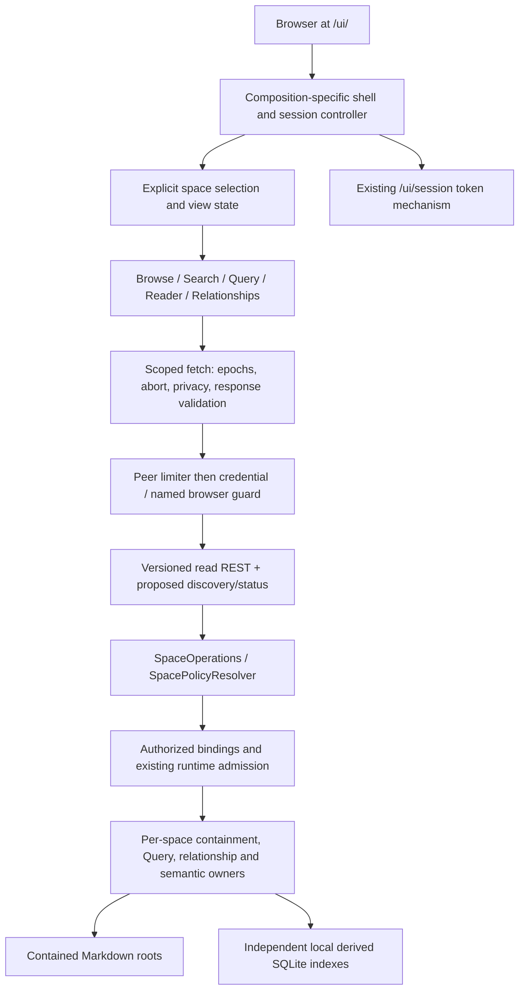

# ADR 0011: Named Knowledge Spaces Dashboard

- **Status: ACCEPTED — architecture/design only**
- **Date:** 2026-11-20
- **Acceptance:** fresh independent architecture/security review APPROVE; owner accepted all six decisions in section 16 on 2026-11-20.
- **Task:** VB-156A, architecture and security design only
- **Implementation authority:** none. VB-156B–E remain future implementation tasks requiring separate authorization.

Acceptance records the reviewed design, not shipped functionality. Proposed runtime additions below
remain unimplemented; named Dashboard/UI/session fences and named REST cookie rejection remain in force.

## 1. Context and existing behavior

The supplied task and the repository's v1.5.0 baseline describe shipped named REST, MCP and CLI
support. This ADR investigates that source baseline; it does not independently certify a release,
image, hosted CI or deployment. Current runtime facts remain in
[ARCHITECTURE.md](../../ARCHITECTURE.md#knowledge-spaces-accepted-runtime-and-public-restmcpcli-composition)
and the [Knowledge Spaces guide](../KNOWLEDGE_SPACES.md).

| Evidence / owner | Implemented behavior and consequence |
| --- | --- |
| [main.py](../../app/main.py), `_application`, `_named_application`, `create_app` | Named composition owns one `SpaceRuntime`, operations facade and limiter. Both compositions currently register the UI router; named middleware fences it before dispatch. A router registration alone does not enable UI support. |
| [named_fence.py](../../app/ui/named_fence.py), `NamedUIFence` | Uses `get_route_path` for root-prefix-aware matching. `/ui` and every `/ui/` path/method return static 404/no-store, without session/body/asset/owner work. |
| [router.py](../../app/ui/router.py), [ui_session.py](../../app/core/ui_session.py) | Explicit shell/assets; 307 `/ui` to `/ui/`; no SPA fallback. Legacy POST session checks current/previous API key and limiter; GET validates/renews; DELETE clears. Tokens use current-key-derived HMAC-SHA256, version/timestamps only, seven-day lifetime. HttpOnly, SameSite=Strict, host-only, Path=/; Secure follows effective HTTPS. GET/DELETE currently have no peer limiter or explicit origin guard. |
| [dependencies.py](../../app/api/dependencies.py), `require_auth` | Cookie plus `X-VaultBridge-UI-Request: 1` works only in legacy mode and only without an Authorization header. Named REST requires Bearer. Current/previous keys authenticate the deployment, not users or space grants. |
| [http_security.py](../../app/core/http_security.py) | Shared direct-peer limiter precedes protected authentication; invalid key is 401; missing server key is 500; limiting is 429 with existing Retry-After. A presented Authorization header takes precedence over cookie fallback. |
| [knowledge_spaces.py](../../app/services/knowledge_spaces.py) | Immutable startup registry, 1–8 definitions, exactly one `default`; finite capabilities/dialects, private labels/roots. Resolver checks all IDs/read policy before capability/dialect/index policy and owner dispatch. No discovery projection exists. |
| [space_runtime.py](../../app/services/space_runtime.py), [space_operations.py](../../app/services/space_operations.py) | One generation with shared scheduler/model/watcher ownership and fenced admission. Root identity and owner bindings are checked by operations. No browser adapter may consume raw owners. `inspect_index` is Hygiene evidence, not a complete Dashboard status contract. |
| [space_reads.py](../../app/api/space_reads.py), [space_read_transport.py](../../app/space_read_transport.py) | Explicit scopes run strict parsing and `SpaceOperations`; singular reads have `{space_id,result}`, plural results have qualified items and selected coverage. Unknown/denied share `403 scope_not_allowed`. Mixed selections fail wholly. Scoped successes and failures are no-store. |
| [knowledge_query.py](../../app/api/knowledge_query.py), [knowledge_query_transport.py](../../app/knowledge_query_transport.py) | POST `/api/v1/knowledge/query` is implemented, always scoped output, including omitted default. Typed predicates, bounds and authorization live on the server. |
| [relationships.py](../../app/api/relationships.py), `execute_scoped` | Public links/backlinks expose verified Obsidian wikilink facts for one space, not every internal relationship dialect. Query supports explicit `obsidian_wikilink` and `markdown_link` predicates. Neither supports cross-space edges. |
| [health.py](../../app/api/health.py) | Named `/health` is admission `{ok}`; `/health/ready` is default-only after semantic/index policy checks; neither describes all spaces. Rich legacy health must not be applied to named mode. |
| [semantic.py](../../app/repositories/semantic.py), `read_availability_status`, [semantic_search.py](../../app/services/semantic_search.py), `state` | Protected-storage availability currently delegates to `read_status`, which includes counts; `state` can initialize lifecycle metadata. Neither is automatically a minimal side-effect-free Dashboard status primitive. B needs a narrow guarded metadata/availability observation helper, not a call to rich health or the state property. |
| [index.html](../../app/ui/index.html), [app.js](../../app/ui/assets/app.js), [search.js](../../app/ui/assets/search.js), [overview.js](../../app/ui/assets/overview.js), [hygiene.js](../../app/ui/assets/hygiene.js), [app.css](../../app/ui/assets/app.css) | Legacy shell/session/navigation, search/reader/relationships, public health and explicit Hygiene scan modules. Text-only rendering, abort/generation guards, local assets; path-only reader identity and rich Overview assumptions prevent simple named reuse. There is no Query form or general note browser. |

Evidence inspected includes [UI sessions](../../tests/test_ui_session.py),
[UI routes/assets](../../tests/test_ui.py),
[public composition](../../tests/test_public_space_composition.py),
[policy reads](../../tests/test_policy_read_adapters.py),
[operations](../../tests/test_space_operations.py),
[Query adapters](../../tests/test_knowledge_query_adapters.py), and
[browser tests](../../tests/e2e/test_dashboard.py). In particular, composition tests assert the
prefix/method fence, old-cookie rejection, default-only readiness without denied probes and mixed
selection rejection before work. Session tests establish previous-key unlock/current-key signing,
rotation, expiry, marker requirement, sliding restoration and limiter behavior. Browser tests
exercise reload/logout, note return context, inert text and stale relationship responses with abort
disabled. These are source assertions; the validation record must distinguish inspection from reruns.

### Decision history and authority

[ADR 0003](0003-web-dashboard-architecture-and-security.md) remains accepted history for bundled
same-origin UI, routing, local assets, rendering and security headers. Its initial sessionStorage /
Bearer design was superseded by completed **VB-076**, documented in
[BACKLOG.md](../../BACKLOG.md#vb-076--persistent-web-dashboard-session--p1-). Do not resurrect it.
Its early exclusion of full-note reading was also superseded by the implemented reader.
[ADR 0009](0009-knowledge-spaces-and-scope-policies.md) remains authoritative for policy, qualified
identity, omission, isolation and federation. Its original future-task wording predates VB-151/152.
Current REST Query and qualified MCP resources are implemented, despite older deferral language.
[ADR 0010](0010-safety-first-e6-cleanup-outcomes.md) continues to govern cleanup uncertainty.

VB-152 deliberately forbids named UI, cookie authentication and registry/label discovery. This ADR
**accepts narrowly replacing those exclusions** through separately authorized implementation, not weakening
the current fence now. No other accepted ADR or historical task is rewritten. Until then all exclusions
remain current truth. No schema, route, dependency or persisted format changes in VB-156A.

## 2. Product problem and goals

An operator who enabled named spaces can use REST/MCP/CLI but cannot browse their knowledge in the
first-party browser. Provide read-only access without requiring API syntax or another application.

| Workflow | Proposed experience | Reuse / new contract |
| --- | --- | --- |
| A — Access | Open `/ui/`, unlock once with existing API key, restore safely, logout; protected views stay empty while checking | Reuse token/cookie mechanism; named validation, guard and composition contract in sections 5/9 |
| B — Selection | Persistent-in-page scope bar; single-space browsing; a separate explicit multi-space Search/Query chooser and Apply action | New filtered discovery; no persisted selection, wildcard or automatic all |
| C — Browse/read | Select one space; list notes, optionally constrain folder and limit; open raw Markdown with `space_id` and relative path always visible; Back restores results/focus | Existing scoped list/read; no fake pagination or directory API |
| D — Search | Literal or Semantic mode, query, optional folder, global result limit; explicit selected spaces, qualified rows, returned order and coverage | Existing search/related APIs; no reranking, implicit mode fallback or client federation |
| E — Knowledge Query | Start with literal/semantic text, folder and tags; expandable typed metadata, qualified path and relationship filters | Existing Query API, no new predicates; section 8 specifies mapping |
| F — Relationships | Verified outgoing wikilinks/backlinks for the reader's one space; resolved local targets open in that space; unresolved text is inert | Existing links/backlinks only; Markdown relationship views require a later adapter contract |
| G — Visibility | Read capabilities per readable space; status for the selected scope on selection/manual Refresh; show disabled, in progress, ready or unavailable separately from search availability and coverage | New selected-space status projection; public health stays unchanged |

Locked named shell offers Access/About and dependency-free liveness only; it has no registry,
per-space overview or rich legacy Overview. Named navigation after unlock is Spaces, Browse, Search,
Query, Access and About, with relationships inside the reader. Hide unimplemented panels at each
slice and disable unavailable capabilities with a reason. Existing legacy navigation stays intact.
Named Hygiene presentation is deferred even though its REST adapter exists; never run the legacy
default-only scan against a multi-space selection.
Enable an Open note action only when that row's source space permits `read_note`; Search/Query
permission alone is insufficient. Load relationship groups only when the reader's space permits
`relationships` and `obsidian_wikilink`. Explain unavailable actions without attempting another space.

Discovery never executes an operation. After unlock/reload, show readable choices; preselect only
`default` if returned, otherwise leave no selection and invite an explicit choice. Do not auto-select
the first/sole readable alternate. A successful session with no readable spaces shows “No readable
spaces available” without suggesting hidden IDs/counts. A readable space with no suitable operation
capability stays visible but its controls are disabled. Changing the browse space resets the Search/
Query selection to that one ID; multiple selection requires a fresh explicit Apply. Opening a
federated result pins a separate reader identity without altering its return selection.

## 3. Options considered

| Option | Benefit | Cost / decision |
| --- | --- | --- |
| A — Operator supplies IDs in browser | No registry publication; least new backend surface | Typing IDs on every reload, capability guessing and typo/denial ambiguity undermine practical use. Reject as primary UX; no free-text discovery/probing fallback. |
| B — Authenticated filtered discovery with automatically selected set | Easy onboarding | Discovery is useful, but treating returned entries as an implicit all-space scope violates explicit selection. Reject automatic selection. |
| C — Filtered discovery plus explicit single/multiple selection | Practical choices, bounded safe metadata, preserves explicit operation scope | **Select.** Deliberately discloses readable IDs/capabilities to deployment-credential holders; requires approval of this privacy amendment. Labels remain private. |
| Browser keeps API key in memory/sessionStorage | Avoid cookie changes | Reintroduces browser-readable deployment secret and superseded VB-070 behavior. Reject. |
| Remove named condition from `require_auth` globally | Small diff | Would grant cookie access to writes/aliases and unrelated future routes without a reviewed boundary. Reject. |
| UI backend duplicates REST operations under `/ui/...` | Can isolate browser surface | Duplicates strict validation/error/cancellation/OpenAPI maintenance. Reuse versioned read contracts with a narrow named cookie branch instead. |
| Accounts/RBAC/OAuth/session store | Individual identities/revocation | No demonstrated need; deployment policies are not per-user grants. Reject extra service/state/lifecycle. |
| New SPA/build service or replacing legacy UI | Flexible framework | Operational/dependency/compatibility cost unnecessary for these views. Keep bundled ES modules and isolated named composition. |

## 4. Selected architecture

One FastAPI process/container, same-origin `/ui/`, static HTML/CSS/ES modules, no mandatory Node
build, CDN, remote font, analytics or browser package dependency. Markdown and local derived SQLite
stay in their existing owners. No new persistent application/browser state; cookie is the existing
exception, plus the bounded content-free browser coordination journal justified in section 5 for
abandoned cookie mutations. It stores no credentials, grants, IDs or note/query content and is not
a session database. Selection, query, reader and return context are memory-only.



The UI cannot authorize anything. All direct or scripted requests reauthorize complete selected
scope on the server. No browser sends roots, resolves filesystem boundaries, merges spaces locally,
parses links, evaluates predicates or derives lifecycle readiness.

## 5. Authentication and session decision

### Token reuse and named validation

Reuse the existing **v1 token format, signing context, cookie name and seven-day lifetime** unchanged.
It contains no mode, ID, capability or permission. A valid legacy-issued token with the same current
key remains valid for named server validation deliberately; it authenticates the same deployment and
still requires new named request guards and server policy. Browser restoration additionally requires
the clean coordination history below; missing history requires explicit key unlock. Drain old legacy
issuers on mode handover. Switching composition does not elevate a token or certify a clean cookie jar.

Keep legacy `require_auth` and legacy session behavior unchanged. Introduce an isolated named
browser validation branch/helper in `dependencies.py` and `ui_session.py`, with route metadata or an
immutable method/path allowlist. Never infer permission from a `/api/v1` prefix or marker alone.
Both `SpaceReadRoute`'s direct dispatch and normal FastAPI dependencies must invoke the same helper
exactly once after the limiter. Use ASGI route path (prefix removed), not raw external URL or
caller-supplied path strings, for route eligibility.

The complete proposed **named cookie allowlist** is:

| Method | Application route | Allowed operation |
| --- | --- | --- |
| GET | `/api/v1/notes/list` | Omitted default or explicit scoped listing |
| GET | `/api/v1/notes/read` | Omitted default or singular scoped note |
| POST | `/api/v1/notes/search` | Literal search |
| POST | `/api/v1/notes/related` | Semantic search |
| POST | `/api/v1/knowledge/query` | Knowledge Query |
| GET | `/api/v1/notes/links` | Local wikilink outgoing facts |
| GET | `/api/v1/notes/backlinks` | Local wikilink backlink facts |
| GET | `/api/v1/knowledge/spaces` | Proposed filtered discovery |
| GET | `/api/v1/knowledge/spaces/status` | Proposed selected status |

These are exact methods, not HEAD/OPTIONS or trailing-slash variants. Redirects, if produced by
existing routing, do not authenticate the redirect response; the canonical target must pass guards.
Browser code uses canonical paths. Cookie auth does **not** extend to `/notes` aliases, create,
append, duplicates, Hygiene, Capture/Promotion, maintenance, `/mcp`, or future endpoints. A cookie
on these protected routes without Bearer receives the existing 401; it is not a write credential.
Public health/privacy remain public and do not use cookies as authorization.

If Authorization is present, verify its exact existing Bearer semantics; never recover from an
invalid/empty Bearer using a good cookie. Current/previous Bearer clients retain all existing route
and policy behavior, including independently authorized writes. MCP remains Bearer-only over HTTP.

### Named browser guard and CSRF

For the allowlisted cookie branch, require a valid cookie **and** exact
`X-VaultBridge-UI-Request: 1`. Apply the following guard to named POST/GET/DELETE `/ui/session` too,
including unlock before issuing cookies. Legacy session requests are unaffected.

1. Reject duplicate marker/Origin headers; require the exact marker. Session guard rejection is
   `403 {"detail":"invalid_ui_request"}`. Missing/invalid cookie on protected reads remains 401;
   when the marker and cookie are valid but origin guard fails, return the same static 403.
2. If Origin is present, require one valid serialized HTTP(S) origin exactly matching the effective
   request origin (scheme, normalized host, effective port). Reject null, opaque, malformed,
   comma-separated or different origins. A proxy prefix is a path, never part of Origin.
3. If `Sec-Fetch-Site` is present, require `same-origin`; reject `same-site`, `cross-site`, `none`
   and duplicate values on these fetch endpoints. A same-site sibling origin is not trusted.
4. Missing Origin/Fetch Metadata is allowed only with the marker (and cookie where required),
   preserving same-origin GET fetch and nonbrowser test/tool compatibility. This is safe under the
   browser custom-header/preflight boundary, not proof that a nonbrowser client is a browser.
5. Add no CORS middleware, cross-origin allowlist, credentialed CORS, JSONP or form-body fallback.
   Unlock accepts only `Content-Type: application/json` (optional charset); reject other media
   types with static 415 `invalid_session_request` before parsing. Retain strict extra-field/invalid
   JSON 422 `Invalid session request` without echoing submitted secrets.

SameSite=Strict plus custom headers and no CORS prevents ordinary cross-site credential use; explicit
Origin/Fetch Metadata checks also reject same-site sibling attacks. Same-origin XSS can still issue
requests; HttpOnly does not make a compromised origin safe. Do not host untrusted apps at this origin.

### Keys, logout, expiry and response behavior

Once current-key rotation is effective on every serving path, old session tokens fail validation,
even when their signing key is configured as previous. Previous Bearer keys may still unlock a
**new current-key-signed session**, matching VB-076;
this overlap is a deployment-credential choice, not narrower grants. Removing the previous key does
not revoke sessions already signed with the unchanged current key. To revoke all, rotate current.

Named session response shapes remain POST/GET `{"authenticated":true}`, DELETE
`{"authenticated":false}`; no mode/registry/grants in tokens or session bodies. **Named GET validates
only: no Set-Cookie, renewal or expiry change on any success, failure, redirect or middleware path.**
Protected reads also never issue/delete cookies. Named sessions expire seven days after explicit
successful POST, with no sliding renewal; extending access requires explicit API-key re-entry.
Legacy GET restoration still renews exactly as implemented/tested; do not change that handler's
legacy behavior. Session GET/POST/DELETE all share the existing
direct-peer limiter in named mode, exactly once, including invalid requests. This is a named-only
addition; preserve existing legacy GET/DELETE behavior. Cookie validation failure is 401; malformed
unlock remains safe 422; bad key retains `401 Invalid API key`; absent server key retains 500.
All named session responses, including redirects, 405/422/429/errors under proxy prefixes, are
no-store. Do not assume the existing raw-path no-store middleware alone covers a prefixed path.

On logout, expired session, protected 401 or failed restoration: synchronously lock/blank protected
state, increment session/selection/view epochs, abort reads, clear credential input, discovery,
status, filters, results, reader and return context. Failed restoration due to network/429/5xx means
unverified/unavailable, with no protected data shown; Retry is explicit. Non-auth errors during an
already authenticated operation do not discard the session. Never show rejected response text.

DELETE clears the same cookie attributes and is idempotent; it needs the named marker/origin guard
but no valid session, so an expired cookie can be removed. GET/read 401 must not expire a cookie in
its own response: a delayed deletion could erase a subsequent explicit login. A current, coordinated
401 enters the logout protocol below; a stale 401 never initiates cookie deletion.
If logout deletion fails (including 429), show “Page locked; session removal not confirmed” and an
explicit Retry logout; do not claim it survives reload. No automatic retry loop.

### Cross-tab session lifecycle and cookie-mutation inventory

The inspected legacy handlers have exactly three cookie-affecting success paths: POST calls
`_set_session_cookie`, GET calls the same helper to renew, and DELETE calls `_clear_session_cookie`.
`test_session_restore_slides_token_lifetime` proves renewal; same-tab browser reload/logout tests
do not test a delayed other-tab response. In named mode the only issuing response will be explicit
successful POST; the only deleting response will be explicit guarded DELETE, including coordinated
401 cleanup. No implicit renewals/deletions, background login, retrying POST or unload/keepalive
session requests. Audit every redirect/error/middleware path for this inventory in B.

Per-tab serialization is insufficient: tab B's old GET renewal, or explicit POST, can reach the
shared cookie jar after tab A's DELETE. JavaScript epochs, AbortController and ignoring response
bodies cannot undo browser processing of Set-Cookie, which happens independently of UI presentation.
Removing renewal closes the restore race at its server source. Explicit POST/DELETE still need
cross-tab ordering, and tab termination can abandon an HTTP response after its Web Lock is released.
The [Web Locks specification](https://www.w3.org/TR/web-locks/) scopes cooperative locks to storage
contexts and releases them on termination; it does not revoke cookies or settle abandoned HTTP.

**Selected protocol:** nonrenewing GET plus one origin-wide exclusive Web Lock for POST/DELETE,
with a bounded durable uncertainty marker. Native Web Locks is required for named protected UI in a
secure context. Use constant lock name `vaultbridge.named-ui-session.v1`, independent of proxy prefix,
space, tab and credential. Never use lock stealing, timer leases, a per-tab fallback or a timeout as
proof that a cookie mutation finished. Ordinary lock waiting leaves the page locked/pending; expiry
of a UI wait must not release an in-flight mutation and claim logout completed.

Only these two fixed localStorage keys are allowed, each at most 512 UTF-8 bytes:

- `vaultbridge.named-ui-session.intent.v1`: a version and random 128-bit logout nonce, written
  synchronously at every logout intent/current-401 cleanup, before waiting for the lock. Only logout
  changes this key; an issuer must never overwrite it. No timestamp, credential or private context.
- `vaultbridge.named-ui-session.journal.v1`: version, the intent nonce captured for the operation,
  phase (`locked|restorable|posting|deleting|logout_pending|uncertain`), a fresh random 128-bit revision
  on every write, and optional random mutation nonce. Only the exclusive lock holder writes this
  record. A clean snapshot includes that revision: a later login is distinguishable even if intent/
  phase match. No record value authorizes REST; it is
  solely a conservative local UI gate. Missing/malformed/inaccessible state never means authenticated.

This narrow persistence exception is necessary to detect a crashed tab after the browser releases
its lock: without a durable marker, a new/reloaded tab cannot distinguish clean completion from an
orphaned Set-Cookie. It replaces neither HttpOnly tokens nor server policy, and records no session
identifier/token, API key, scope, user data or query history. Fixed size/key count, no event ledger,
expiry worker or server database. Do not reset an unresolved marker merely because it is old.

| Operation / lifecycle | Required behavior |
| --- | --- |
| First visit / missing journal | Keep private state locked; under the lock initialize a locked journal only as part of a fresh explicit key-unlock flow. Do not silently adopt an existing cookie when coordination history is missing. Old tokens remain valid server credentials under current-key rules, but are not proof of a clean browser lifecycle. |
| Explicit POST login | Capture current intent before joining the lock queue. Under the lock re-read intent/journal; cancel a queued action if intent changed or phase is logout_pending/uncertain. A fresh login requires a deliberate form action after confirmed logout, not replay of a queued action. Write posting with mutation nonce **before sending**; retain lock until a complete known HTTP response is consumed and cookie effects are settled. Only then record restorable (or locked after a complete nonissuing rejection), bound to the captured intent. If intent changed during POST, never unlock/publish success: leave the mismatching record for pending logout to delete after this completed issuance. |
| Concurrent explicit logins | Same lock serializes them; no automatic replay of credentials. A queued login predating any logout intent is cancelled even if credentials were valid. An intentional new login after completed logout can establish a new session and is not resurrection. Clear submitted key inputs/references on completion or cancellation. |
| GET restore / retry / reload / pageshow / focus | Obtain a short locked snapshot: only matching restorable journal/intent permits the nonissuing GET. Release lock during GET so it need not delay logout. After response/JSON, recheck intent, journal and UI epochs before any protected state/request. GET never changes cookie or journal to restorable after logout; failed/old restoration cannot unlock. A locked or mismatching journal requires explicit login or pending logout completion, not automatic restoration. |
| Logout / current coordinated 401 | Explicit logout immediately blanks/aborts local private state, publishes a new intent nonce and notifies siblings, then joins the exclusive lock. For a 401, first acquire the lock and compare the exact captured clean journal revision/intent; if newer login/logout occurred, ignore the stale 401, otherwise publish its new logout intent while holding that lock. Cancel queued old-intent logins. A still-live POST holder must finish its response first. After acquiring the lock, reject any abandoned dirty mutation; otherwise record deleting before guarded DELETE, consume its complete response, then record locked for the captured current intent only on confirmed deletion. A newer intent always fences old completion. Show browser-cookie removal confirmed only for this settled, non-ambiguous path. |
| Complete DELETE rejection (e.g. 429/403) | If its complete response demonstrably has no cookie effects, record logout_pending; keep all protected UI locked and offer explicit Retry logout under the lock. Block login/restore until confirmed deletion. No success or automatic retry claim. |
| Mutation network error/abort, stream failure or holder reload/close/crash | Leave posting/deleting marker unresolved (or mark uncertain while still holding lock). Any later lock holder finding that dirty record knows the old holder ended without recorded settlement: quarantine all named protected UI, including login/restore, across reloads. No new issuance; do not treat lock availability, tab-close, abort or a later DELETE as proof that the orphaned response cannot arrive. |
| Ordinary close/reload with no mutation outstanding | No session request in unload handlers. Clean restorable journal permits validation-only restore; locked/logout_pending/uncertain state remains fenced. Pagehide may abort reads/GET because none affects cookies; it must not deliberately abort a live POST/DELETE or clear its marker. Actual termination may interrupt it, invoking quarantine. |

Before every protected fetch and again before rendering, compare the current intent/journal with the
captured clean restorable snapshot as well as existing epochs. On change, blank/abort immediately
when observed. `storage` events and optional native BroadcastChannel provide content-free lock
notifications; receivers re-read the records rather than trusting message order. BroadcastChannel
is an optimization, not mutual exclusion, durable history or an acknowledgement barrier. Missing/
delayed/dropped broadcasts cannot authorize restoration. It is limited to eligible shared storage
contexts, as specified by the [HTML messaging standard](https://html.spec.whatwg.org/multipage/web-messaging.html#broadcasting-to-other-browsing-contexts).

**Unsupported-browser fallback:** if secure context, working Web Locks or readable/writable shared
localStorage is unavailable, show the public shell and “Named browser sessions unavailable”; do not
issue POST/GET/DELETE session calls or protected reads, even if a cookie already exists. No memory-only
or BroadcastChannel-only fallback and no browser-held Bearer workaround. REST/MCP/CLI and legacy UI
retain their current contracts. BroadcastChannel absence alone is supported with storage-event and
per-operation checks, tested separately. Private browsing/partitioned profiles qualify only if their
cookie jar, locks and journal share the same tested top-level partition; embedding is unsupported.

**Conservative uncertainty recovery:** orphaned issuance/deletion can still affect the cookie jar;
the UI must say “Session outcome uncertain; browser access blocked”, never “logged out everywhere”.
There is no in-page reset or time-based escape. Recovery requires operator-confirmed drain/termination
of the old session-issuing process/requests, current-key rotation when an old token may remain usable,
then explicit browser cookie/control-record clearing and fresh login. Clearing site data while old
issuance is unresolved is not safe recovery. A best-effort cookie deletion cannot certify settlement
of a still-orphaned response. Storage failure during mutation is the same uncertainty case.

**Guarantee and limit:** for supported, cooperating tabs on one canonical application origin with
intact journal, a completed non-ambiguous logout follows every earlier settled cookie mutation;
late validation-only GET cannot recreate the cookie or unlock a tab. A subsequent deliberate login
is allowed. The journal fail-closes compliant UI after ambiguous mutations; it cannot prevent browser
cookie processing, reject replay directly at REST, retract already returned content or revoke a valid
token on the server. Notifications are not universal immediate clearing of suspended tabs. Copied/
orphaned signed tokens remain valid until expiry/current-key rotation. Global immediate revocation
would need a separately justified server-side revocation/generation design, which is not selected.

Reject sliding GET renewal (unnecessary issuer), per-tab locking/epochs alone (no cookie ordering),
BroadcastChannel-only coordination (no exclusion or durable crash evidence), and Web Locks alone
(termination releases locks before HTTP settlement). Do not add server revocation storage for this
read-only release; accept fixed expiry and documented quarantine instead. Enabling named UI requires
draining/closing old legacy pages and in-flight session responses on the hostname; the legacy
renewing handler must not remain an uncoordinated cookie issuer alongside named mode.

### HTTPS, prefixes, caching and history

Keep HttpOnly, SameSite=Strict, Path=/, no Domain, matching deletion attributes and Secure when ASGI
sees HTTPS. Preserve HTTP for existing local deployments; remote operation should use HTTPS. Use
trusted server/proxy configuration for effective scheme/host; never trust arbitrary client
X-Forwarded-* values inside the guard. Test direct HTTPS and a trusted TLS-terminating proxy profile.
If a proxy hides HTTPS, Secure cannot be inferred safely; document/fix that deployment configuration.
**Deployment trust boundary: the entire hostname, including every TCP port. Recommend a dedicated
VaultBridge hostname**, for example `vaultbridge.example.test`, rather than a port on a shared NAS/
application hostname. An origin additionally includes scheme/port for fetch, Web Locks and storage;
cookie matching does not. A different HTTPS application's server on the same hostname can receive
this cookie on direct browser requests to its port, despite the application's origin guard/CORS.
It can capture/replay the signed token or overwrite/delete the same-name cookie in an HTTP response.
HttpOnly prevents JavaScript reading it, not that other server receiving it. This is explicitly
documented in [RFC 6265](https://www.rfc-editor.org/rfc/rfc6265#section-8.5).

| Existing cookie property | Protection and boundary; none provides TCP-port isolation |
| --- | --- |
| Secure | Sends the cookie on secure transport; unrelated HTTPS listeners on the same hostname remain eligible. It does not bind a cookie to one HTTPS port. |
| HttpOnly | Blocks non-HTTP script access; matching HTTP requests still carry it to servers. |
| SameSite=Strict | Restricts cross-site delivery. Changing port on the same HTTPS hostname is not a cross-site boundary. |
| Path=/ | Matches the whole host path namespace, including proxy prefixes; paths are not application security boundaries. |
| Host-only (no Domain) | Restricts destination hostname, excluding sibling/subdomain destinations; it does not distinguish ports or protect against unrelated applications on that same host. |

Required deployment/acceptance conditions: one canonical HTTPS scheme/hostname/port for named UI
session issuance and one trusted application deployment under that hostname. All listeners and
reverse-proxy routes on that hostname must be under the same trusted administration; no unrelated
HTTPS app, legacy Dashboard instance or alternate-port named session issuer. Alternate public
listeners may redirect to the canonical origin **without** issuing cookies or receiving API-key
POST bodies; the UI never follows session-fetch redirects. Do not expose a non-Secure named session
on remote HTTP. Existing legacy/local HTTP runtime support remains unchanged; a loopback secure-
context exception is eligible only with the same entire-hostname trust and tested coordination.
Web Locks/journal are origin/partition-scoped and cannot coordinate cookie issuers on different
ports; trusting those ports alone does not make multiple independent issuers safe.

Preserve reverse-proxy prefixes and trusted forwarded scheme/host handling. A dedicated hostname
may expose VaultBridge under `/proxy`; cookie Path=/ and lock/journal names deliberately span that
prefix. Prefixes, different keys, cookie names or cookie-path narrowing are not replacements for
hostname trust. The application cannot verify what unrelated services listen elsewhere on the host:
operator acknowledgement and deployment guide requirements are release gates, not an inferred
guarantee from a passing Origin or TLS test. Path scoping/renaming the cookie is outside this change.

Derive shell/asset/API URLs from canonical `/ui/` and `document.baseURI`, retaining proxy prefix.
No hard-coded origin-root URL; test `/proxy/ui` redirect and every session/read under `/proxy`.
No private data in HTML/bootstrap, URLs/fragments, document title, history.state, sessionStorage,
localStorage, IndexedDB, Cache Storage, service workers, analytics or console logs. Search/Query use
POST bodies. Existing GET scope/path parameters can reach proxy access logs but never page history;
keep proxy log redaction as operator guidance, not an application guarantee.
Only the two bounded nonsecret lifecycle records above are allowed in localStorage. Their loss or
corruption denies automatic restoration; do not store a credential, protected response or scope there.

Named shell/session/discovery/status and every response on the named cookie read allowlist use
`Cache-Control: no-store`, including omitted-default success/error and authentication failures.
Scoped REST already does this; explicitly cover the omitted compatibility branch. Browser fetch uses
`cache: "no-store"`, `credentials: "same-origin"`, `redirect: "error"` for all protected/session
fetches, and accepts only same-origin constructed URLs. Canonical requests need no redirect; rejecting
redirects before following prevents even a 307 from forwarding a secret/query body to another origin.
Static assets contain no private state and retain CSP headers.
No-store alone does not prove BFCache erasure: `pagehide` aborts/clears protected DOM/state; `pageshow`
and visibility/focus restoration blank before session validation and fresh discovery. Page navigation
does not serialize return context; Back within the reader is in-page and memory-only.

## 6. Space discovery and authorization decision

### Proposed GET /api/v1/knowledge/spaces

Register **only in named composition**, operation ID **`listKnowledgeSpacesV1`**. No aliases, MCP tool,
CLI discovery, request body, query selectors, wildcard, pagination or label search. Reject unexpected
query parameters/body with safe 422 `invalid_request`, after auth. Legacy composition retains 404.
Authentication is existing current/previous Bearer or the guarded named cookie branch in section 5;
limiter then credential, before policy projection. No anonymous registry, even for read-allowed IDs.

Minimum response (all fields required, no extra properties):

```json
{
  "spaces": [
    {
      "space_id": "default",
      "read_capabilities": ["list_notes", "literal_search", "read_note"],
      "relationship_dialects": ["obsidian_wikilink"],
      "indexing": "disabled"
    }
  ]
}
```

`spaces` is 0–8 entries sorted by ASCII ID; IDs retain `[a-z][a-z0-9_-]{0,63}`. Return exactly the
immutable registry entries whose **read policy allows**, even if their owners/indexes are unavailable
or they support none of these UI operations. This is pure policy metadata, never operational status.
Implement a dedicated allowlisted projection owned by `SpacePolicyResolver`, reached through
`SpaceOperations`; adapters do not serialize `KnowledgeSpaceDefinition` or access `_definitions`.
The resolver may inspect all configured **policies** to filter; it must not touch any owner, root,
index, model, filesystem, label or derived-data binding. Never call an operation on all discovered IDs.

`read_capabilities` is a sorted unique subset of exactly `read_note`, `list_notes`, `literal_search`,
`semantic_retrieval`, `knowledge_query`, `relationships`, intersected with configured capabilities.
It reports policy permission, not runtime availability. `relationship_dialects` is a sorted subset of
`obsidian_wikilink`, `markdown_link` only when `relationships` is permitted, otherwise `[]`.
`indexing` is configured `enabled|disabled`, independent of `semantic_retrieval` permission. Do not
expose write policy, write capabilities, Hygiene/duplicates, labels, roots, DB paths, binding tokens,
root hashes, registry totals, hidden count, denied count or omitted-entry indicators. No `default_id`
field: a denied default is not disclosed by discovery. Configuration still requires exactly one.

200 `{"spaces":[]}` is valid when no entries are readable; do not distinguish absence from hidden
spaces. Discovery failure is all-or-nothing static 500 `internal_error`; do not return a partial
registry or raw exception. Use existing 401/429/500 credential semantics and 403 browser-guard
semantics. Every response is no-store, no ETag/Last-Modified/304; no client persistence/polling.

**Publication/privacy amendment:** holders of the deployment credential can now learn every
read-allowed logical ID and these policy facts without knowing IDs beforehand. This is intentional
and requires owner acceptance of this ADR before B. All such holders see the same deployment policy;
IDs are not identities or per-user ACLs. Listing readable entries discloses their count inherently,
but never any unauthorized ID/count/metadata. No claim of constant-time registry projection is made;
it is bounded to eight policy entries with zero denied-owner work. Private labels lack a publication
approval mechanism and are unnecessary for eight stable IDs, so remain omitted. Adding display
labels later needs its own opt-in publication contract.

Required discovery regression: anonymous/cookie-only/marker-only rejected; current/previous Bearer
and guarded cookie succeed; all-read-denied empty; denied default absent; unavailable readable ID
still listed; capability/dialect subsets exact and sorted; labels/roots/denied sentinel IDs never
appear in body/headers/logs/errors; instrument owners/filesystem/model to fail on any access;
extra query/body, methods, prefix, no-store/conditional GET, shared limiter, legacy 404 and unchanged
MCP tool inventory. Discovery cannot authorize a subsequent operation.

### Selection and whole-request authorization

UI selection contains exact returned IDs; requests always send explicit `space` or `spaces`, including
explicit `default`, so strict qualified shapes are used consistently. Empty selection blocks submit;
it is never translated to omission or an empty-array “all”. No Select all button, wildcard, inferred
registry set or fallback on failure. API omission by other clients remains default-only.

For multi-space Search/Query, display chips/checkboxes with one named group, visible active IDs and
Apply/Cancel. Capability eligibility is the intersection across all selected spaces and the requested
mode/predicates. Explain an unsupported capability; do not silently remove a space or predicate.
The server revalidates raw count 1–8 (before deduplication), syntax, all read policies, requested
capabilities/dialects/index policy before owner/index/filesystem work. Unknown and denied IDs return
identical 403 `scope_not_allowed` without echo. A mixed request fails wholly. Availability partials
are possible only after complete authorization. Discovery is never a grant/cache of grants.

On a 403 selection failure, blank scoped results/status/reader, retain session, invalidate selection
and offer explicit Reload spaces; use one generic message. On reload, reauthorize via new requests;
never select a replacement automatically. Authorized unavailable spaces stay selected with safe
unavailable/coverage feedback and manual retry. No hidden existence test or alternate-space read.

## 7. UI component architecture

Prefer an isolated named entry document (proposed `app/ui/named.html`) at the same `/ui/` route and
named bootstrap, rather than teach every legacy controller two response shapes. Shared CSS/logo and
small pure text/URL helpers may be reused. Do not rewrite working legacy modules solely for reuse.
The following filenames are proposed module boundaries, not new dependencies or runtime code in A.

| Component / proposed owner | Responsibility | Must not own |
| --- | --- | --- |
| `app/ui/named_router.py`, `named.html`, `assets/named-app.js` | Named shell, exact asset/session registration, accessible panel navigation, initializing available slice modules | Registry serialization, direct owners, generic static/catch-all routing |
| `assets/named-session.js` | Nonrenewing restore, origin-wide POST/DELETE Web Lock, bounded uncertainty journal/intent, epochs, notifications and fail-closed lifecycle | Keys/tokens in readable storage, scope grants, cookie-revocation claims or per-tab mutation fallback |
| `assets/spaces.js` | Discovery validation, explicit single/multiple selection, selection epoch, active scope bar, capability hints | Policy authority, inferred all, per-space content cache |
| `assets/scoped-client.js` | Same-origin URL encoding, cookie marker/cache options, method allowlist, signal composition, safe error categories, response/selection identity validation | Raw owner access, predicate evaluation, automatic retries/federation |
| `assets/browse.js` | One-space bounded list/folder/limit form, loading/empty/limited results, reader return context | Directory tree discovery, fictitious cursor pagination |
| `assets/named-search.js`, `query.js` | Explicit Search/Query forms and wire mapping, show server order and scores, submit only on action | Client ranking, arbitrary JSON execution, semantic fallback |
| `assets/note-reader.js` | Qualified identity, raw Markdown `textContent`, fresh read, return focus/scroll/results in same epoch | HTML/Markdown execution, editing, external resource loads |
| `assets/relationships.js` | One-space returned wikilinks/backlinks, independently loaded groups, qualified local navigation, render cap | Parsing/resolution, cross-space links, graph persistence |
| `assets/coverage.js`, `space-status.js` | Typed coverage/status validation, per-selected-space facts, partial/unavailable/limited explanation, manual refresh | Global readiness or percentages inferred from counts |
| `SpaceOperations` / resolver + proposed `api/knowledge_spaces.py` | Policy projection and selected read-only status; REST handles limiter/auth/strict wire/error projection | UI decisions as permission, serialized raw registry/owner structures |

### Cancellation and stale responses

Use a session epoch, selection epoch, view epoch and per-request sequence; capture an immutable
selection/reader identity at dispatch. Each content/read request has an AbortController registered
with its session/view, plus any caller signal. Cookie-mutating POST/DELETE use section 5's independent
coordinator lifetime and must never join the view/logout abort group. Validate response shape,
selected coverage IDs and item
qualified identities against that snapshot before presentation. Results outside selected scope or
a mismatching one-space envelope are rejected as an invalid response; never rendered or followed.

| Event | Synchronous transition | Late completion handling |
| --- | --- | --- |
| Space selection Apply/change | Increment selection/view epoch, abort searches/list/reader/relationships/status, clear all scoped content and filters with qualified references; update scope label | Check epochs both after fetch and after JSON parsing, before DOM/focus/status updates |
| New overlapping search or mode/filter submit | Increment that request sequence, abort earlier request, clear previous result/reader, show loading | Only newest sequence in same session/selection/view can finish, including errors and finally handlers |
| Open another note / Back | Increment reader/relationship sequence, abort old reads; pin new `(space_id,path)` or restore memory-only result view | No old title/path/content/link may overwrite current reader; Back never revives invalidated scope |
| Logout / current 401 / restoration invalid | Lock/clear private state and abort reads; section 5's shared intent/revision protocol fences tabs, serializes cookie mutations and quarantines abandonment | Ignore stale successes/errors; old-epoch/revision 401 cannot delete a new login; late GET has no cookie effects; no mutation abort as proof of logout |
| Panel navigation away | Deactivate departing controller, abort all its work, increment view epoch; clear reader/relationships | No hidden panel response updates or unexpected focus changes; Search form/result context may remain only within same live scope/session |
| `pagehide` / hidden / focus restoration | Abort reads and blank private DOM/state; do not intentionally abort cookie mutations or erase dirty journal; return checks shared lifecycle then validates/rediscover if clean | BFCache cannot re-show private content before validation; close/reload mid-mutation quarantines; no protected automatic query replay |

Abort is an optimization; generation/identity checks are the correctness boundary. Backend reads
reuse `run_read`/`run_async_read` and existing cancellation token/admission draining. Disconnect
cancellation publishes no successful partial result. Native/model calls may drain to a safe boundary;
neither instant cancellation nor a wall-clock completion guarantee is promised. A new selection
does not create another runtime/model/worker or bypass the existing admission queue.

Use semantic landmarks/headings, native buttons/select/radio/checkbox controls, associated labels,
field-level validation and a skip link. Keyboard operation covers unlock, chooser/Apply/Cancel,
search, reader and Back with restored initiating focus; do not move focus on background completion.
Use `aria-busy`, polite status announcements and meaningful error focus on submitted validation.
Reflow at 320 CSS pixels, wrap IDs/paths, retain visible focus and contrast, reduced-motion support,
and distinguish loading, no results, partial, limited, denied and unavailable with text, not color.

## 8. REST/API contracts and required additions

### Existing interfaces to reuse unchanged

| Workflow | Existing request in named UI | Actual response / restrictions |
| --- | --- | --- |
| Browse | GET `/api/v1/notes/list?spaces=research&limit=50`, optional nonempty `folder` | `ScopedReadOutput[NoteMatchOutput]`; browse submits exactly one ID, though API supports plural |
| Literal | POST `/api/v1/notes/search` with `query`, `spaces`, optional `folder`, `limit` | Qualified `items`, `coverage`, `state`, `ordering`, `result_limited`; no local merge |
| Semantic | POST `/api/v1/notes/related` with `text`, `spaces`, optional `folder`, `limit`, `min_score` | `SemanticMatchOutput`; permission/index-disabled/incompatible selection fails capability checks, not silent partial authorization |
| Read | GET `/api/v1/notes/read?space=research&path=Notes%2FExample.md` | `{space_id,result:{path,content}}`, verify returned space and canonical relative path |
| Query | POST `/api/v1/knowledge/query` | Same scoped result types as list/semantic, including omitted default by other clients |
| Relationships | GET `/api/v1/notes/links` or `/backlinks` with `space` and encoded `path` | `{space_id,result:{links:[...]}}` or `{space_id,result:{backlinks:[...]}}`; wikilinks only; space inherited by every local target/source |

Use `URLSearchParams` for GET/repeated spaces; never concatenate IDs/paths into filesystem-like URLs.
Omit optional empty folder/text fields instead of sending null/empty values. Explicit list/literal/
semantic limits are global 1–100, defaults 50/10/5 respectively. Query defaults 20/max 100. UI offers
only useful limit presets within these ceilings; semantic `min_score` stays 0.28 unless deliberately
set by the user, with finite 0–1 validation. Literal text is at most 8,192 UTF-8 bytes; semantic text
4,096; folder/path 1,024. Bounds remain server-enforced; do not raise them for the browser.

Qualified rows retain `identity:{space_id,path}` and all returned score/snippet/title fields. Keep
equal paths across spaces as distinct rows and DOM identities; a structured tuple/JSON key avoids
separator-collision bugs. Show space and path even when titles match. Browser never deduplicates
by title/path alone, reranks rounded scores or changes the selected scope on row open.
Raw Markdown is shown in a wrapping/preformatted text reader with an accessible label, not rendered
HTML. No inline images, embeds, clickable arbitrary URLs or authored wikilink interpretation.
Only verified server-returned local relationship paths become navigation buttons. Current adapter
relationship payloads have no complete/partial envelope: show “Returned wikilink relationships” and
“No returned wikilinks/backlinks”, not “No relationships anywhere”. Retain the current 20-visible-row
cap per group with an explicit display-limited notice, no invented pagination/completeness claim.

Coverage fields remain exactly those in `CoverageOutput`: `space_id`, `state` (`complete|partial|
unavailable`), `reasons`, `semantic_index_basis`, `enumerated_paths`, `evaluated_paths`,
`returned_candidates`. Preserve reasons `root_unavailable`, `index_unavailable`, `discovery_limit`,
`path_limit`, `alias_limit`, `content_limit`, `relationship_limit`, `semantic_limit`, `note_unavailable`.
Basis is `none|compatible_ready|compatible_previous_refresh|compatible_previous_error`.
Envelope state is `complete|partial`, separate from `result_limited` and ordering
`canonical_path|modified|semantic`. Display previous-refresh/error evidence prominently, including
available results from a previous compatible index; ready/complete is not freshness or an atomic
multi-root snapshot. No executable selected contribution means safe unavailable failure; an available
empty contribution is a valid empty result. Do not claim complete coverage when any row is partial.

### Knowledge Query form mapping

Initial fields are `literal_text`, optional `semantic_text`, `folder`, `tags` and `limit`, with current
explicit `spaces`. At least one actual constraint is required; scope/limit alone is invalid. Advanced
controls support the existing predicates without exposing budgets, scoring internals or raw JSON:

- `paths`: 0–64 qualified `{space_id,path}` entries, each ID inside selected scope; OR within paths.
- `tags`: 0–16 exact portable tag strings; AND across tags. Do not silently normalize into a new
  substring/case-insensitive matching language; domain normalization remains server-owned.
- `metadata`: 0–16 `{key,operator,value?}` rows. Operators exactly `exists`, `equals`, `not_equals`,
  `sequence_contains`. `exists` omits value. Other operators require a typed scalar; explicit controls
  distinguish string, boolean, null, signed 64-bit integer and finite portable number. No objects,
  arrays, JavaScript coercion or `parseInt` truncation. Preserve large integers losslessly in JSON
  using a narrowly validated decimal serializer; never round through JS Number. If such serialization
  is unavailable, block that input visibly instead of sending a changed value.
- `relationships`: 0–16 `{direction,other:{space_id,path},origin?}` rows. Direction exactly
  `incoming|outgoing`; origin `obsidian_wikilink|markdown_link` or omitted for both dialects.
  `other.space_id` must belong to selected scope. Relationships remain local per candidate's space;
  selecting two spaces does not create an edge. Omitted origin requires both configured dialects.

Tags/metadata/relationships are AND-composed, with typed comparison and current limits from
`knowledge_query_schema()` (keys 256 bytes, scalar strings/tags 1,024; finite numbers). All count
limits apply before normalization. Server rejects duplicate JSON keys, non-finite values, unknown
fields, out-of-scope qualified paths and unsupported predicates before work. The form may expose a
useful subset first, but cannot silently strip a configured advanced predicate or widen its scope.
Semantic Query additionally requires semantic capability/indexing; relationships require their
capability/dialects. One unsupported selected space fails the request. Do not substitute literal
Query when semantic execution is unavailable.

### Proposed GET /api/v1/knowledge/spaces/status

Register only in named composition, operation ID **`getKnowledgeSpaceStatusV1`**, no aliases/MCP/CLI.
Authenticate/limit exactly like discovery. Accept only repeated `spaces` query parameters, raw 1–8
valid IDs before deduplication; omission means default only. Reject empty/null-like/malformed,
`space`, wildcard, unexpected parameters or any body with existing safe `422 invalid_scope` or
`422 invalid_request` as appropriate. Explicit default is valid. Strictly authorize **all** selected
read policies before any owner/scheduler/index/filesystem inspection; unknown/denied mixed scope
fails wholly with `403 scope_not_allowed`. The read-policy check is pure, not an artificial requirement
for LIST_NOTES or HYGIENE. Extend the policy owner with this narrow read-metadata/status operation;
do not add a user-configurable capability or serialize internal registry objects.

Minimum response (all fields required, no extras):

```json
{
  "spaces": [
    {
      "space_id": "research",
      "index_state": "indexing",
      "search_available": true,
      "refresh_required": true
    }
  ]
}
```

Exactly one row per authorized selected ID, sorted ASCII; no unselected rows/counts. `index_state`
is `disabled|not_permitted|indexing|ready|unavailable`; the two other fields are booleans. This is an
observation, never a promise that the next search succeeds or that Markdown is fully indexed.

Projection order and semantics are mandatory:

1. After whole-selection read authorization, `indexing:disabled` yields `disabled,false,false` with
   **zero** owner/scheduler/index probes, including old stored rows. Otherwise absent
   `semantic_retrieval` yields `not_permitted,false,false` with zero such probes.
2. For remaining selected bindings only, obtain a read-only scheduler summary and minimal semantic
   lifecycle/compatibility/availability snapshot through `SpaceOperations` and the existing bound
   semantic owner. Preserve root/storage identity guards. Do not use `semantic.state` if it can
   initialize/persist state; expose a small side-effect-free owner projection based on existing
   `read_availability_status`/compatibility semantics. Its current protected-storage branch performs
   rich counts, so a minimal repository observation helper is explicitly in B's scope: reuse guarded
   root/storage binding and read-connection ownership, read only required metadata and chunk existence,
   never bypass binding checks or use SQLite immutable mode against a live WAL database. If observation
   cannot be performed without creating storage/sidecars, report unavailable instead. No `count_notes`,
   SQL table counts, vault walk, chunk enumeration,
   model load, initialization, sync, retry, repair or cache creation.
3. Never hold scoped admission while acquiring the scheduler condition lock (`RuntimeSpaceIndexLifecycle`
   explicitly separates these). Authorize and snapshot scheduler through a facade-owned safe helper,
   release that lock, then enter ordinary cancellable admission for root/storage observation. These
   are non-atomic observations; shutdown/rebinding checks cannot be bypassed with an old binding.
4. Root/binding/storage observation failure gives `unavailable,false,true`. For healthy observation,
   `search_available` uses the existing compatible-index availability rules, independently of
   indexing lifecycle. `refresh_required` is true if scheduler running/continuation, queued work,
   full-sync/monitoring recovery debt, paused/error, or persisted lifecycle not ready. Use a minimal
   boolean scheduler projection rather than publishing/sorting queued private paths.
5. When scheduler is not paused/failed and work is actually running or queued, show `indexing`.
   Debt alone is not progress. `ready` requires compatible ready lifecycle, searchable index and
   no refresh/monitoring debt. All other eligible states are `unavailable` (including uninitialized,
   paused/error, incompatible storage or recovery debt without runnable work). A previous compatible
   searchable index may give `unavailable,true,true` or `indexing,true,true`; keep those facts separate.

After full authorization, individual operational unavailability is a 200 row, even if all rows are
unavailable, because this endpoint reports status rather than retrieving results. Admission stopped/
saturated or request cancellation retains existing 503 semantics, no successful cancelled snapshot.
Unexpected errors are static 500 `internal_error`. No private paths/exception strings/progress
percentages/counts/timestamps/signatures. All success/error/method responses no-store; no conditional
caching/ETags. Initial selection and explicit Refresh only; no background polling of the registry.
Test policy-first zero probes, lock ordering, side-effect-free snapshots and each mapping above.

### Error handling shared by views

Keep current statuses and safe `detail` categories: `400 invalid_path`, `403 scope_not_allowed`,
`404 note_not_found`, `409 capability_unavailable`, `413 size_limit`, `422 invalid_scope` /
`invalid_request`, `503 space_unavailable` / `semantic_unavailable` / `operation_cancelled`, and
`500 internal_error`. Authentication/limiter retain their existing texts/headers. Parse only an
allowlisted category, never arbitrary response text. Show rate limiting with a valid Retry-After
and explicit action; do not fan out/retry until enough results arrive. A missing note clears the
reader, preserves authorized result context and permits Back. Capability errors retain session,
show a reason and require explicit correction; unavailable semantics leaves literal mode available
as a separate deliberate user action. Unknown errors become generic unavailable feedback.

## 9. Legacy compatibility strategy and fence migration

Mode remains selected only by `settings.knowledge_spaces_json is None` versus explicit named
composition. No browser query parameter, cookie, discovery error, health shape or API failure chooses
mode. Named `/ui/` serves the inert named document; legacy `/ui/` continues to serve `index.html` and
existing controllers. The named entry contains no configuration or private bootstrap data.

In B, change application composition to register the appropriate UI router, not both and not an
order-dependent fallback. Reuse existing cookie helpers with named guards layered in an isolated
path. Preserve the legacy router/session/resource semantics byte-for-byte where practical. Maintain
an explicit named UI allowlist: `/ui` GET/HEAD redirect, `/ui/` GET/HEAD document, canonical session
POST/GET/DELETE and only the bundled assets needed by delivered named modules GET/HEAD. Unknown
named paths/assets remain static 404/no-store, no catch-all and no fallthrough into mounted MCP.
Registered unsupported methods use safe 405/no-store; trailing slash redirects, if retained, cannot
bypass marker/origin/no-store rules at the target. Gate checking must precede body/session work on
unregistered paths. Keep `NamedUIFence` unchanged until the B foundation tests pass; then replace its
blanket exclusion with this explicit named-route gate as the final composition change in that slice.

B is a usable Access/Spaces/status foundation, with Browse/Search/Query unavailable until their
slices land. It must never initialize the legacy overview/search/Hygiene controllers. Security
regression is required in **every** slice; E is final integrated hardening, not the first browser test.
Update the current-state guides and VB-152 exclusion notes only when that replacement actually lands,
preserving VB-152 as dated history with a link to the new accepted contract. No activation flag is
needed: released named composition supports exactly the modules registered by that implementation.

Preserve old REST paths, aliases, operation IDs, omitted-default response shapes/limits/errors,
MCP transports/tools/resource URIs and write opt-in, CLI behavior, Markdown/provenance bytes,
SQLite/index signatures/layout, ranking and lifecycle owners. New routes/IDs are additive in named
mode only; existing operation IDs remain identical. Legacy UI cookie behavior is untouched. Named
Bearer semantics remain unchanged; named browser access is a deliberately narrower additive channel.
Health/privacy stay unversioned and unchanged. No Dashboard filesystem shortcuts or raw roots.
The one normal image already bundles `app`; Docker/TrueNAS ports/mounts/UID/GID, packaging and
release automation need no architecture change. Verify eventual assets in the normal image, but do
not infer catalog/form/deployment/lifecycle readiness from that test.

## 10. Security and failure threat model

The trusted boundary is the application/policy/containment owners, not the browser. The deployment
operator and OS can access configured data; this is not tenant isolation. All fixtures below must
be disposable synthetic spaces/credentials. “Current” describes inspected protection, not a claim
that the proposed named browser guard or endpoint already exists.

| Risk and attack/failure scenario | Current protection | Proposed protection | Required automated regression |
| --- | --- | --- | --- |
| Cross-space disclosure: browser changes an ID or follows a forged result into another root | Resolver before owners, root containment, qualified scoped identities; named cookie/UI fence | All reads through SpaceOperations, scope snapshot and envelope validation; UI choices never grant authority | Direct HTTP tampering with valid cookie; deny/missing ID before every owner probe; response outside selection discarded; symlink/root replacement cannot read peer space |
| Enumeration: anonymous/credentialed caller seeks denied IDs, counts, labels or roots | No registry endpoint; static safe unknown/denied errors | New discovery pure read-policy filter only, allowlisted fields, no labels/total; no policy metadata for denied entries | Denied sentinel IDs/labels/private roots absent in every response/header/log; instrument all owners to fail; all-denied empty; default denied absent; unknown=denied body/status |
| Mixed allowed/denied selection returns some allowed data first | Whole-scope resolver check precedes work | Same atomic authorization for reads/status; discovery is not a grant | `[allowed,denied]` and `[allowed,unknown]` fail identically with zero filesystem/index/scheduler calls, even if allowed space would fail |
| Equal paths/titles: reader, backlink or result cache opens wrong space | Domain pair identity and per-space owners | Pair identity in DOM/state/navigation; fresh read and space envelope validation | Same `Notes/Plan.md` and title in two roots; open each from one federated result, Back and navigate local backlinks; distinct content and IDs, no path-only cache |
| Forged/expired/replayed session, rotation overlap misunderstood | HMAC, bounded timestamps, current-key-only validation, HttpOnly/SameSite | Same token implementation, named route allowlist; explicit copied-token residual risk | Forged/version/future/expired/oversized token; same-key restart and mode switch; current rotation rejects token despite previous overlap; previous key unlock signs current; no scope claims accepted |
| Cookie accidentally authenticates writes or new routes | Named blanket rejection; legacy API cookie mechanism is broader | Default-deny exact named read methods; Bearer has precedence | Valid cookie+marker rejects create/append, aliases, Hygiene, duplicates, MCP and unsupported methods; invalid Bearer+valid cookie is 401; Bearer write regression unchanged |
| CSRF/login/logout CSRF via foreign or same-site sibling origin, form POST or null Origin | Strict SameSite, custom marker for legacy protected calls, no CORS; named fence | Named marker plus Origin/Fetch Metadata guard including session endpoints, JSON-only unlock, no cross-origin redirects | Browser foreign/sibling origin with OPTIONS/simple form; null/malformed/duplicate Origin/marker; cross-site/same-site Sec-Fetch-Site; no cookie issuance/body work on rejection; same-origin and marker-only nonbrowser compatibility |
| XSS from Markdown/title/tag/metadata/link alias or raw error | CSP, textContent, raw text reader, no remote scripts | Same strict CSP and text-only rendering for every new field; only server-verified local navigation | Payloads with HTML/script/event handlers/javascript URLs in all display fields; assert inert text and zero network/image/script execution, no innerHTML sink |
| Private path/error leakage from filesystem/index failure or validation | Scoped public_error static categories, structured logging; external proxy logs outside app control | Allowlist new metadata/errors; generic response parse failures; no raw errors/IDs in routine logs | Inject raw exception/SQL/private paths/secrets; safe body/header/log assertions, malformed session/query bodies never echoed; no client console errors containing private content |
| Stale results/401 or cookie resurrection after logout/navigation/concurrent login | Legacy epochs suppress DOM updates, but renewing GET still mutates shared cookies independently | Named GET has no Set-Cookie; origin-wide POST/DELETE Web Lock, durable dirty marker, intent/revision checks and uncertainty quarantine | Two-tab held-before-headers GET after completed logout; POST/logout ordering; stale 401 cannot delete new login; tab-close/orphan POST/DELETE remains blocked across reload; no focus steal |
| Index disabled, fails, stale previous data or partial coverage is presented as ready/complete | Semantic capability/index policy, scoped coverage/basis and finite budgets | Independent state/availability/refresh facts, per-selected coverage, no automatic semantic-to-literal switch | Disabled with stale DB has zero probes; no capability zero probes; queued/running/paused/debt/previous-error matrix; one-root failure partial, all result contributions unavailable 503, available-empty 200 |
| Default-only health misleads user about registry | Named minimal health, default-only policy-gated readiness | Named shell never feeds legacy rich Overview; status explicit selection only | Nondefault usable/default denied; no “all ready”, no unselected state/counts/probes; direct default health contracts unchanged |
| Cookie stolen by unrelated HTTPS server on same hostname/another port; proxy/TLS confusion | Host-only/Secure/HttpOnly/SameSite restrict cookie use but provide no port isolation; origin guard cannot protect cookie delivery to another matching server | Dedicated VaultBridge hostname, trust all its listeners/routes, one canonical session issuer; prefix-compatible trusted scheme/host and matching Path=/ deletion | Two TLS ports same hostname: demonstrate automatic cookie delivery/server visibility despite HttpOnly and rejected cross-origin fetch; different dedicated hostname receives no host-only cookie; root/prefix/TLS/forged-forwarding matrix |
| Federated query DoS or queue flooding | Peer limiter, one active operation/64 waiters, scoped work ceilings, cancellation | One server federated request, submit/manual refresh only, no automatic retries/polling; status no scans/models | One shared limiter decision per request incl. unlock/discovery/status; saturation/cancel recovery; selected 1–8/limit bounds; no new worker/model; status no query/content/index initialization |
| Cached protected responses, history, reload/BFCache or sibling tab retains content | Session/scoped no-store, memory-only legacy results; logout/401 clear page | No-store, lifecycle blanking, clean-journal validation-only restore/re-discovery; storage-event checks plus optional broadcast, no protected persistence | Conditional GET/redirect/405/401/429 no-store under prefix; storage contains only bounded nonsecret lifecycle keys; browser Back/hidden return and multi-tab paths; missing API/storage support denies protected UI |
| Accidental writes/promotion through read UI or relationship navigation | Named scope/write opt-ins, CLI-only capture/promotion, contained owners | No write controls/requests; cookie read allowlist independently denies writes; no inferred destination | Browser request inventory rejects all mutation/maintenance; assert filesystem/DB unchanged for discovery/status/read flows; no cross-space promotion controls or endpoints |

No frontend test substitutes for direct server denial tests. Do not claim resistance to compromised
same-origin script/proxy/OS, stolen deployment keys, malicious operator config, hardlinks/hostile
writers, browser extensions, screen capture, or universal constant-time/latency behavior.

## 11. Performance and resource considerations

Keep one shared runtime, scheduler, model and existing bounded admission. The browser sends one
explicit federated REST request, never eight independent searches followed by a JavaScript merge.
Retain `scoped_budget.py` current aggregate/per-space ceilings and deterministic budget allocation:
20,000/10,000 paths; 100,000/25,000 entries; 10,000/2,500 directories; 2,000,000/500,000 probes;
100,000/50,000 semantic rows; aggregate semantic/content byte ceilings 268,435,456 each; existing
SQLite step/cancellation limits. These are current work ceilings, not UI-configurable knobs or a
latency service level. Per-space semantic windows remain `min(500,max(limit*5,limit))`; maximum
4,000 local candidates before global merge. Do not change ranking, budgets or storage to add UI.

Global output stays at most 100 hits; keep only current results, one note up to existing MAX_NOTE_BYTES
and bounded relationships, discarding previous scope content. List is bounded with a visible
result-limited notice and folder/limit refinement; it is not a complete tree or infinite list.
Discovery examines at most eight policy entries and no data. Status observes at most eight selected
authorized semantic bindings with minimal read-only metadata, not vault/DB counts or chunks. Small
owner-local helpers for these projections are justified; new dependencies/services/caches are not.

Initial discovery and selected status do not execute search/Query/backlinks/Hygiene automatically.
Expensive operations require an explicit Run/Search action; relationships load only after a
successful note read and only in D. Use existing bounded server paths, per-group render caps and
cooperative cancellation. No polling, WebSocket, SSE, automatic refresh/retry, background browser
indexing or per-space sessions. Test observable resource behavior before making performance claims.

## 12. Failure and recovery behavior

The shell/assets may load while locked, but named private content does not. Session success and
space availability are different states. Discovery failure shows a generic retry state, never a
legacy/default fallback; a successful empty discovery is a valid no-access state. A denied default
never selects another space automatically. Mode mismatch/malformed bootstrap or response locks the
affected controls rather than guessing legacy/named schemas.

Status can truthfully report disabled/not-permitted without touching an unavailable root. Status
snapshots are non-atomic and not promises of search coverage/freshness; render actual subsequent
coverage independently. Index/root loss does not delete/recreate/rebuild derived state. Authorized
operation partials keep exact selected-space coverage; denied mixtures never become partial results.
One note read failure clears its content and relationships while retaining the in-memory result
return context in that epoch. Relationship-group failure does not erase an already authorized note.

On rate-limit/network/503 after an established session, keep the credential/session but clear the
failed view's old result before new submission and show explicit retry. A cancellation is not an
empty result or user-visible server failure. A current 401 clears protected state and enters
the coordinated logout protocol in section 5. A nonissuing GET failure may be explicitly retried;
an unsettled POST/DELETE quarantines named browser access, with no automatic/reset-by-age recovery.
Reload revalidates/discovers only after a clean restorable journal check; locked/missing/mismatching
or uncertain history does not auto-restore. There is no stored query replay.

Runtime startup/shutdown, stopping generations and uncertain native cleanup continue under ADR 0010.
The UI cannot force restart, cancellation completion, repair, reindex or admission. No new lifecycle
control API; stopped/saturated execution returns existing safe failure. Operators use existing
documented recovery outside the browser, with no promise of cross-process coordination.

## 13. Independently reviewable implementation slices

All slices use `agent_task.py -> changes -> agent_finish.py -> separate fresh review`. A successful
packet is not approval. Each implementation starts only after owner acceptance of this ADR and its
own exact task; no B–E code is authorized by A. Each slice includes its own security/backend/browser
tests, additive documentation and current-state corrections where behavior actually changes.

### VB-156A — Architecture, security and UX contract

- **Outcome/scope:** reviewable proposed architecture, evidence table, precise auth/discovery/status/
  selection/compatibility contracts, threats and phased plan. Files: this ADR, BACKLOG, minimal ROADMAP
  and ARCHITECTURE proposal links. No endpoint/schema/runtime changes.
- **Compatibility/security:** all existing runtime fences/contracts remain intact. Accepted ADRs are
  preserved. No secrets/private notes or real roots in examples.
- **Positive acceptance:** another session can implement B using sections 5–9 without choosing token,
  cookie, scope, discovery, status or gate semantics. Every new publication boundary is marked proposed.
- **Negative acceptance:** no named UI shipment/acceptance/completion claim, code/test/dependency/
  packaging/CI changes, B–E work, commit/push/deploy or implementer review.
- **Validation/DoD:** local links/fragments and IDs checked, schemas compared with source, docs-only
  selector/checks pass, fresh packet created. Separate fresh architecture/security review returned
  APPROVE; owner acceptance recorded on 2026-11-20. VB-156A is complete for architecture/design only;
  no implementation dependencies or B–E implementation authority.

### VB-156B — Named session foundation and authorized space selection

- **User outcome:** open `/ui/` in named mode, unlock/restore/logout, see only readable choices, apply
  a single or explicit multi-space selection and view selected capabilities/status. No content views yet.
- **Exact scope/files:** `main.py`, isolated named UI router/document/bootstrap/session/scoped-client/
  selection/status modules, `named_fence.py`, `ui_session.py`, `dependencies.py`, necessary
  `space_reads.py` auth/cache integration, proposed `api/knowledge_spaces.py`. Add pure resolver metadata
  projection in `knowledge_spaces.py`, facade methods in `space_operations.py`, minimal side-effect-free
  observation helpers in `semantic_search.py`, `semantic_scheduler.py` and `repositories/semantic.py`.
  Repository scope is only guarded metadata/chunk-existence reading without the current rich-count
  fallback, initialization or persistence-format changes. Do not change
  lifecycle/scheduler execution or copy raw ownership into the UI router. Existing app.css/logo reuse.
- **Endpoints/schemas:** exactly two new named-only GET routes/operation IDs/schemas in sections 6/8.
  Reuse session bodies and token format; named guard/rate rules and exact cookie read allowlist in
  section 5. Register only delivered named assets, no generic directory mount. Preserve old IDs/schemas.
- **Compatibility/invariants:** legacy session/UI unchanged; Bearer/MCP/CLI unchanged; omission remains
  default-only. Final activation replaces blanket fence only after the B denial tests pass. Policy-first,
  no grants in token, no labels/roots/hidden counts, no disabled/unselected probes, no content walks or
  initialization/status writes, no admission/scheduler lock inversion.
- **Positive acceptance:** current and previous keys create current-signed sessions; same-key session
  restores across process restart with clean shared history and no renewal; mode handover drains legacy
  issuers and missing journal requires explicit key unlock. Readable unavailable choices still list; selection remains explicit;
  status mapping incl. previous searchable index is honest; empty readable set and denied default are
  understandable. Prefix-relative shell/session/API work at root and `/proxy` with direct/proxied HTTPS
  on one canonical origin under a dedicated hostname; all hostname ports/routes are trusted.
- **Negative acceptance:** cookie-only/marker-only/forged/rotated/expired fail; invalid Bearer never falls
  back; cookie cannot write/use aliases/MCP; origin/form/duplicate-header attacks fail before protected
  work. Mixed scope denied wholly; discovery/status leak no hidden data; no legacy controllers initialize
  in named shell. Completed clean logout cannot be undone by old GET; abandoned mutations remain
  quarantined across reload/tab closure. Missing Web Locks/secure context/shared storage never falls
  back to per-tab sessions. Another HTTPS port cannot be treated as an isolated cookie trust zone.
- **Required tests:** extend `test_ui_session.py`, `test_ui.py`, `test_public_space_composition.py`,
  `test_policy_read_adapters.py`, `test_space_operations.py`; add focused discovery/status/guard tests,
  including instrumented zero-probe and read-only filesystem/model/SQLite checks, method/prefix/cache
  matrix and scheduler lock/cancellation safety. New named Playwright fixture uses synthetic disjoint
  roots and no downloads, with actual production factory; cover unlock/reload/logout/selection/empty/
  status/no-write and every session/hostname regression in section 14 on Chromium, Firefox and WebKit,
  including feature-failure fallbacks and actual cookie-jar checks, not only DOM epochs. Freeze legacy
  OpenAPI IDs and MCP inventory. Run canonical
  selector-selected full checks, including legacy Chromium. Native Windows plus actual WSL/Linux for
  any changed root/storage/admission interaction; do not substitute platform mocks for such evidence.
- **Dependencies/non-goals/DoD:** accepted A and scoped B; no browse/read/search/Query/relationships UI,
  named Hygiene, maintenance, rendering library, persistence beyond the two lifecycle records,
  dependencies or packaging. B is complete
  only after all selected/required tests, current docs, packet and separate approval. Do not defer B's
  security tests to E. Any materially larger status-owner change needs its own bounded subtask first.

### VB-156C — Scoped browsing, reader and federated Search

- **User outcome:** browse one selected space, open raw Markdown, return to the same list/results and
  focus; literal/semantic search across an explicitly chosen set with qualified rows and coverage.
- **Exact scope/files:** named shell modules plus `browse.js`, `named-search.js`, `note-reader.js`,
  `coverage.js`, minimal named HTML/CSS and explicit asset routes. `scoped-client.js` validates existing
  scoped result schemas/identity. Backend business logic/ranking is unchanged.
- **Endpoints/schemas:** no new endpoints or changed existing payloads. Use list/read/search/related
  exactly as section 8; only additive static asset registration.
- **Compatibility/security:** preserve legacy UI and server omission semantics; requests in this UI
  always explicit. One-space browse/read, explicit plural search, no path-only state key, no Markdown
  HTML, no automatic fallback, full epochs/cancellation/401/privacy behavior.
- **Positive acceptance:** matching paths/titles in two spaces remain distinct; encoded Unicode paths,
  single/multi-space literal/semantic modes, empty results, limited list and complete/partial coverage
  work. Back preserves live selection/filter/order/scroll/focus; subsequent reader open fetches fresh.
- **Negative acceptance:** denied/mixed request, unsupported/disabled semantic selection, all unavailable,
  bad/mismatched payload, deleted note and private error never show wrong/old content. Late success/error
  with abort disabled or delayed JSON after selection/logout/navigation cannot update any view.
- **Required tests:** named Playwright Browse/Search/reader/Back, one/all unavailable and previous-basis
  coverage, matching paths, XSS/network assertions, cookie/no-write request inventory, delayed fetch/
  JSON with abort disabled, responsive/keyboard smoke. Existing scoped backend adapters, containment,
  cancellation and legacy UI/OpenAPI regression plus all selector-required checks.
- **Dependencies/non-goals/DoD:** approved B; no Query/relationships or Hygiene UI, directory API,
  pagination contract, mutation, reranking, stored query/history or backend refactor. Exact acceptance,
  current docs, required checks and independent approval before calling C delivered.

### VB-156D — Knowledge Query and local relationship views

- **User outcome:** use practical Query filters and inspect verified local outgoing wikilinks/backlinks
  from a read note without writing API JSON or losing the federated return context.
- **Exact scope/files:** `query.js`, `relationships.js`, named shell/form/asset registration and reader/
  scoped-client/coverage integration. Map every supported advanced predicate in section 8 with typed
  inputs; semantic/literal server evaluation stays unchanged. Reuse current Query adapter and local
  relationship payloads; no parser/domain reimplementation.
- **Endpoints/schemas:** none new. Query remains `queryKnowledgeV1`; relationship views remain
  `listNoteLinksV1` / `listNoteBacklinksV1`. No new Markdown relationship-list or cross-space graph API.
- **Compatibility/security:** same local space on relationship navigation; Query qualified references
  must be inside explicit selected scope. Capabilities/dialects compose before work; preserve AND/OR,
  typed scalars, count/text bounds, exact integer transport and omitted-origin requirement.
- **Positive acceptance:** literal/semantic/composed Query, all four metadata operators, true versus 1
  versus string/null, signed-64-bit boundary serialization, exact tags, paths, incoming/outgoing and
  each/both origins map exactly. Returned order/coverage unchanged. Independent relationship groups
  show returned facts, empty/failure and display cap honestly; verified targets open same-space notes.
- **Negative acceptance:** out-of-selection references, empty Query, unsupported dialect/capability,
  missing/invalid values, non-finite/overflow/rounded integer and excessive arrays are rejected safely;
  form never drops a predicate. Cross-space edge invention, unresolved link navigation, stale reader/
  group responses and executable metadata fail tests. Hidden scope changes cannot reuse old filters.
- **Required tests:** extend Query adapter parity/validation tests only if needed for observed bugs;
  add named browser form-to-wire assertions against production REST, typed/limit errors, all dialect
  capability combinations, local relationship equal-path isolation, delayed group race with abort
  disabled, inert text and keyboard/focus. Run existing Query/scoped/relationship and legacy browser
  contracts plus selector checks. A new backend bug/contract change requires a separately bounded fix.
- **Dependencies/non-goals/DoD:** approved C; no new Query language, alias graph, cross-space links,
  Markdown relationship views, graph editor, named Hygiene or writes. Predicate/identity evidence,
  docs and all checks plus independent approval required.

### VB-156E — Integrated browser, accessibility and release hardening

- **User outcome:** the complete read-only named Dashboard behaves predictably across supported
  layouts/session/coverage/failure/proxy scenarios, with legacy behavior retained and accurate docs.
- **Exact scope/files:** focused named/legacy UI fixes, `tests/e2e/` production-factory fixtures and
  journeys, session/composition/security regressions, `docs/DASHBOARD.md`, `docs/KNOWLEDGE_SPACES.md`,
  release checklist and factual ARCHITECTURE updates. Normal-image verification may use existing
  disposable image tooling; no Dockerfile/TrueNAS/CI redesign or publication is implicit.
- **Endpoints/schemas:** none; freeze B additions and every prior route/operation ID. Any further
  contract change stops for a scoped decision rather than being hidden as hardening.
- **Compatibility/security:** run the full threat matrix, both compositions, same-origin CSP, no-store,
  no mutations, selected-only coverage and native lifecycle limits. Browser credentials/content never
  enter URLs/storage/logs/history or exported screenshots.
- **Positive acceptance:** end-to-end unlock/restore/space selection/browse/search/Query/relationships/
  Back/logout; keyboard-only flow, 320px reflow, long IDs/Unicode, contrast/focus/reduced motion; root/
  proxy/TLS paths. Normal production image serves exactly bundled assets and no external dependencies.
- **Negative acceptance:** expired/rotated/copied token behavior, failed deletion, foreign/sibling origin,
  BFCache/visibility/multi-tab including abandoned cookie mutations and shared-hostname/different-port
  risk scenarios, all stale/abort-disabled races, denied/mixed scopes, index failure/debt/
  partial/empty and queue saturation cannot leak or misrepresent data. No automatic retry/query replay.
- **Required tests:** full canonical Python/evaluation and Chromium suites selected by tooling, all
  named security/browser tests from B–D, Docker checks when selected/required by hardening scope,
  synthetic exact-image smoke and explicit root/proxy HTTPS browser tests. Run section 14's complete
  session matrix on Chromium, Firefox and WebKit in addition to the selector's Chromium gate; a missing
  engine/path is unavailable required evidence, not covered by Chromium. Accessibility automation
  using existing stack plus a recorded keyboard/responsive inspection; add no package by default.
  Report actual browsers/platforms/skips. Native Windows and actual WSL/Linux when owner/native code
  was changed earlier; reuse exact retained evidence only with source identity, never imply a rerun.
- **Dependencies/non-goals/DoD:** approved B–D. Current docs and complete required evidence, packet and
  separate approval establish source readiness only. Release number/date, commit/push, GHCR/catalog,
  deployment and real TrueNAS lifecycle are separately authorized actions, not E completion.

## 14. Testing strategy and architecture validation

Use the existing test owners instead of a duplicate authorization model. Backend tests exercise actual
factory composition/REST, not only the JavaScript wrapper. Instrument root/owner/scheduler/index/model
entry points so denied, unselected, disabled and pure-discovery calls fail on any work. Verify safe
errors/headers/logs as well as status codes. Freeze all existing API IDs and legacy payloads; compare
new route schemas with section 6/8 and test named-only registration. Run existing MCP/CLI parity and
write opt-in tests to prove browser changes have no wider credential effect.

Browser fixtures must isolate settings before importing module-level app construction, following
`tests/e2e/conftest.py`, with disposable disjoint roots, synthetic credentials, offline semantic
fixtures and no real vault/cache/model download. New named fixtures use `create_app`/runtime and
actual REST; interception is for failure/order injection, not proof of backend authorization.
Repeat response-order tests with AbortController.abort disabled and delayed JSON, plus old-epoch
401 and delayed session Set-Cookie cases. Browser network inventory must contain only local assets,
session methods and allowlisted reads, never mutation or external URLs. UI changes require legacy
Chromium regression as well as named tests from their first slice.

### Required cross-tab session regression and browser qualification

The named session contract is qualified on **Chromium, Firefox and WebKit**, each in top-level pages
sharing one browser context/cookie jar and storage partition, at root and a proxy prefix on HTTPS.
Feature support is detected, not inferred from an engine/version label. B must run the session paths
below on all three engines (using existing Playwright's browser selection); E repeats the matrix on
the integrated source. Existing selector Chromium checks alone do not satisfy this additional gate.
Unsupported-feature branches are required tests too; a missing browser/test environment is missing
required evidence and must not be reported as a pass. Legacy lifetime/session/browser tests remain
unchanged, including renewal, and are run separately so the named-only exception cannot regress them.

**Deterministic two-tab delayed-renewal regression, no timing sleeps:**

1. Use tabs A/B in one context, explicitly login A, establish clean journal and a valid cookie.
   In B start a GET restoration; at the production-handler/server transport barrier validate/capture
   its response but hold delivery **before its headers reach the browser**. GET holds no mutation
   lock during network I/O. Disable abort in this test; delaying JSON alone does not test cookies.
2. In A perform logout; wait on observable DELETE completion, journal locked state and cookie-jar
   removal. No explicit login occurs after that logout intent. Verify B is already fenced when it
   observes the intent; do not rely on broadcast delivery for the safety assertion.
3. Release B's delayed response headers/body. Against the old renewing handler this schedule delivers
   Set-Cookie after deletion and demonstrates the finding; the future named handler must have **zero
   Set-Cookie on this response**, with unchanged token expiry before logout. Check actual headers and
   automation-visible HttpOnly cookie jar, not JavaScript visibility or only DOM messages.
4. Assert the cookie stays absent, both pages show no protected content, old GET success cannot mark
   the journal restorable, and reloading B cannot restore access. A direct guarded GET after deletion
   returns 401/no Set-Cookie. A fresh deliberate key login after completed logout is a separate allowed
   action. Keep the legacy-renewal reproducer isolated: it is evidence of history, not a named fallback.

Additional mandatory backend/browser cases:

| Path | Deterministic assertion / required failure boundary |
| --- | --- |
| All GET/session/read outcomes | Named restore success, expired/forged/missing token, 401/403/405/422/429/5xx, redirects and prefix variants never issue or delete cookies. Repeated successful restore does not change token timestamps, cookie expiry or journal revision. Backend tests inspect headers on every relevant handler/middleware branch. |
| Held live POST then logout in another tab | Hold issuer response headers while its lock/dirty marker remains live. Logout intent fences all UI, DELETE cannot pass the mutation lock and logout is not reported complete. Release issuer, observe cookie applied, then DELETE clears it; old queued login/GET never reopens UI. Repeat reverse ordering and two competing explicit logins. |
| Old response after a newer deliberate login | Hold an old GET 401/deletion candidate or success, complete a new explicit login, then release old response. No cookie deletion/renewal from GET; revision comparison rejects old cleanup/presentation. Epoch tests alone are insufficient. |
| Closed/reloaded issuer | Hold POST before headers, close/reload its tab so Web Lock is released; another tab sees dirty journal and must quarantine without issuing login/restore. Release the orphan response if transport permits; cookie jar may change, but protected UI stays blocked and no successful/global logout is claimed. Test abandoned DELETE too: a late clear must never race a new permitted login. If a given engine aborts delivery, still assert quarantine rather than assuming that every engine/network path does so. |
| Network/storage failures | Abort/error/partial body on POST/DELETE, lost lock holder, quota/security/read/write failure or malformed/missing journal cannot authorize a new session or clear uncertainty by timeout/retry/reload. Complete DELETE 429/no cookie stays logout_pending until explicit coordinated retry succeeds. Losing both records prevents silent cookie adoption; clearing data while issuers exist is outside the clean guarantee, not safe recovery. |
| Ordinary restore/reload/tab close | Clean reload/browser reopen and background/focus/BFCache return validate without Set-Cookie; clean close does not delete or extend sessions. Locked/logout_pending/uncertain state remains fenced. Initial missing history requires explicit unlock. No keepalive/unload session request. Fixed seven-day expiry and effective current-key rotation are enforced. |
| Missing/late notifications | Disable BroadcastChannel; delay/drop storage/broadcast events and suspend B. Shared-record checks before fetch and after GET/JSON prevent restoration when B resumes; no immediate clearing promise for frozen tabs. Test current/previous keys, current-401 cleanup and failed DELETE through the same coordinator. |
| Unsupported browser/context | Missing/rejected Web Locks, insecure context or inaccessible shared storage yields public shell only: no cookie POST/GET/DELETE, protected request or per-tab/Bearer fallback. BroadcastChannel absent but other required features working remains supported. Test storage partitions/private contexts explicitly before claiming support; unrelated profiles are separate sessions. |
| Mode/proxy handover | Drain legacy GET/POST before named activation; named requests cannot use old legacy controllers/renewal. Test one canonical root/prefixed HTTPS deployment; alternative origins cannot create independent cookie issuers under the deployment acceptance contract. |
| Bounded journal privacy | Exactly two keys within size bounds; no key/token/ID/path/query/content. Intent/revision mismatch rejects stale state; dirty records never expire into permission; unrelated scope/index behavior remains unchanged. |

### Required hostname/port negative security scenarios

Use synthetic cookies/keys and disposable TLS servers, never a real NAS hostname or credential.
On each supported browser, serve VaultBridge at `https://vaultbridge.example.test:PORT_A` and a
test-only unrelated receiver at the **same hostname** on `PORT_B`. After login, top-level navigate
to the receiver's matching `/probe` path; assert its HTTP server receives the HttpOnly session cookie
despite Secure/SameSite=Strict/no Domain. Demonstrate why the deployment is rejected: origin checks
can reject a cross-origin API call, but cannot stop direct cookie delivery to that other server.
The receiver may also set/delete the same-name/path cookie; application TLS and UI DOM checks do not
isolate it. Token replay from a server is not prevented by a browser Origin check. This is an expected
negative demonstration, not a test that should pretend cookie isolation by port exists.

Then put the receiver at a **different hostname**, `other.example.test`, and verify VaultBridge's
host-only cookie is not sent. Repeat canonical reverse-proxy prefix/direct HTTPS, trusted termination,
port-mismatched Origin rejection, cookie creation/deletion attributes and different-origin lock/
storage isolation. Assert documentation/owner gates prohibit alternative cookie issuers and unrelated
applications across **all** ports/routes of the VaultBridge hostname, including shared NAS default
hostnames. A separate hostname does not waive ordinary same-origin XSS/proxy/parent-domain trust;
do not claim that a browser test certifies actual deployment listeners or universal cookie integrity.

For A, verify local Markdown targets/fragments, task-ID uniqueness and cross-references, proposed
versus current claims, accepted-ADR compatibility, actual route/schema/capability names and privacy;
check only documentation is changed. Run `agent_check.py` and `agent_finish.py` with the original
task source; docs-only may select no runtime suites. Record inspection versus execution and any
unavailable check. No runtime suite or deployment is claimed by this ADR. The generated fresh packet
is for a separate session, not an independent review performed by the author.

## 15. Explicit exclusions

- General note editing/create/append/delete, arbitrary file operations, uploads, rename/move, section
  updates, link repair, automatic writes, promotion or Capture UI, cross-space promotion.
- Accounts/users/groups/RBAC, OAuth, another auth service, server session database, persistent policy
  store, per-user ACLs, hot reload or changing the deployment-credential model.
- Labels published without a new opt-in contract, anonymous registry, implicit all/wildcard scopes,
  client-side authorization, denied metadata, configured roots/data paths or private diagnostics.
- Cross-space graph relationships, graph editor, client relationship parsing, new public Markdown
  relationship views, ranking/predicate/semantic model changes or index/schema migrations.
- Named Hygiene/duplicate UI, rich all-space health, index maintenance/rebuild/retry controls,
  synchronization progress percentages or an atomic multi-root snapshot claim.
- Separate frontend service/container/port, required Node/npm build, major dependency/framework,
  CDN/analytics/fonts, service worker or persistent browser query/history/cache state.
- Docker/TrueNAS/release/CI changes in A, implementation B–E, commit/push/publication/deployment or
  independent review in the architecture-authoring session.

## 16. Risks, consequences and owner acceptance gates

The design makes named knowledge usable through the existing application and owners, with a small
bounded metadata surface and no service/database/build dependency. Isolated composition costs a
small named shell/module set but avoids silently changing legacy contracts. Shared helpers should
be extracted only where direct tests justify them; two full business-logic implementations are not
acceptable. Accessibility, safe lifecycle and failure presentation require meaningful browser tests,
not only endpoint success tests.

The important residual costs are readable-ID discovery to every deployment-key holder, stateless
session revocation limits, entire-hostname trust (including every port), fail-closed uncertainty
recovery and the bounded nonsecret browser journal, non-atomic status and
index observations, and potentially expensive bounded federated reads. None is solved by a visual
selector. Status must stay a narrow observation, not grow into registry diagnostics or maintenance.
Raw Markdown and wikilink-only relationship views intentionally trade presentation richness for
small surface, current adapter fidelity and no rendering dependencies.

The owner accepted all six reviewed decisions below on 2026-11-20 after the fresh independent
architecture/security review returned APPROVE. B still requires separate authorization; browser,
deployment and implementation acceptance gates below remain future requirements:

1. Replace VB-152's blanket named UI/cookie exclusion with section 5's read-only allowlist and
   section 9's exact composition gate, retaining all other exclusions and legacy behavior.
2. Permit authenticated policy-filtered disclosure of all readable IDs and the exact metadata in
   section 6, without labels, totals or a new visibility flag. No public registry or per-user claims.
3. Add the two exact named-only versioned GET contracts, including narrow selected operational status
   and its no-probe/side-effect/lock-order rules; public health remains unchanged.
4. Reuse existing stateless tokens across modes with current-key rotation/previous-key unlock and
   copied/orphaned-token limitations; adopt nonrenewing named GET, Web Locks for cookie mutations,
   the two bounded nonsecret persistent lifecycle records and conservative uncertainty recovery.
   Missing required browser features disables protected named UI; no universal immediate revocation.
5. Accept the read-only raw-Markdown/wikilink-first UX, explicit in-memory selection and staged B–E
   delivery without named Hygiene, writes, graph features or a release promise.
6. Require a dedicated VaultBridge hostname with all its ports/proxy routes trusted, one canonical
   session issuer, secure-context browser support and a drained legacy-session handover. Neither
   origin/port separation nor Secure/HttpOnly/SameSite/Path/host-only attributes isolate cookies by
   port. Operator acknowledgement and all supported-browser negative/session tests are acceptance
   gates; source tests cannot establish that a real deployment's other listeners are trusted.

These are accepted design choices, not unresolved instructions for an implementer to invent.
Changing them requires an ADR/contract amendment before implementation. This ADR is **ACCEPTED**
and VB-156A is complete for architecture/design only, based on the separate APPROVE review and owner
decision, not packet creation. VB-156B–E remain future implementation work; no named Dashboard
functionality, release or deployment is claimed.
